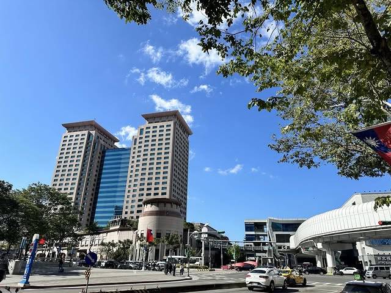
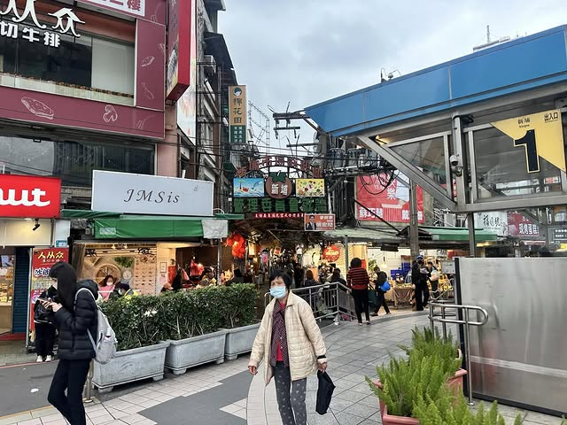

# 第一屆 Threads 板橋在地人必吃美食大賽

## 摘要

@chinlantea 發起「Threads 板橋在地人必吃美食」徵集，邀請網友提名店家。[Threads 原貼文](https://www.threads.com/@chinlantea/post/DQqTbGZkQ5O)

這篇是社群提名彙整，不代表作者逐店探訪或背書。貼文顯示 509 則回覆；以下記錄目前載入可見的留言，並非完整名單。留言中的店家資訊與營業細節未另行核實，前往前請再確認。

## 內文或摘錄

> 我自行宣布  
> 第一屆《Threads 板橋在地人必吃美食》大賽  
> 正式開始  
> 選手如下：

## 目前可見提名

### 網友推薦

@imjacob_henderson 分享「板橋新埔站附近美食」名單：

1. 大碗公當歸羊肉
2. 港豐撈麵飯堂
3. 唐媽媽特色川菜
4. 沈記蘿蔔絲餅
5. 無骨鵝肉
6. 好盤美味廚房
7. 秦記排骨
8. 56巷口湯包
9. 鴨香飽
10. 9號雞蛋糕

@fromjleslip 推薦光仁側門旁的「東一大雞便」（留言者說大家都這樣稱呼），提到大碗約 NT$65。

@xuan0512_ 推薦密陽屋韓式料理，留言稱位置在新北市政府對面、六必居旁巷內；中午常客滿，建議晚上前往，並提到炸醬麵、小菜與白飯可續，以及當時韓式炸雞約 NT$180。地點及價格以留言發布時資訊為準。

## 圖片

以下依主貼文順序保存 2 張街景照片，分別呈現廣場周邊建物與市場／車站周邊街景；均為 JPEG，640 × 480。

目前可見留言串中未見作者回覆；部分留言仍摺疊，無法確認所有回覆。其他使用者留言所附媒體未收錄。
