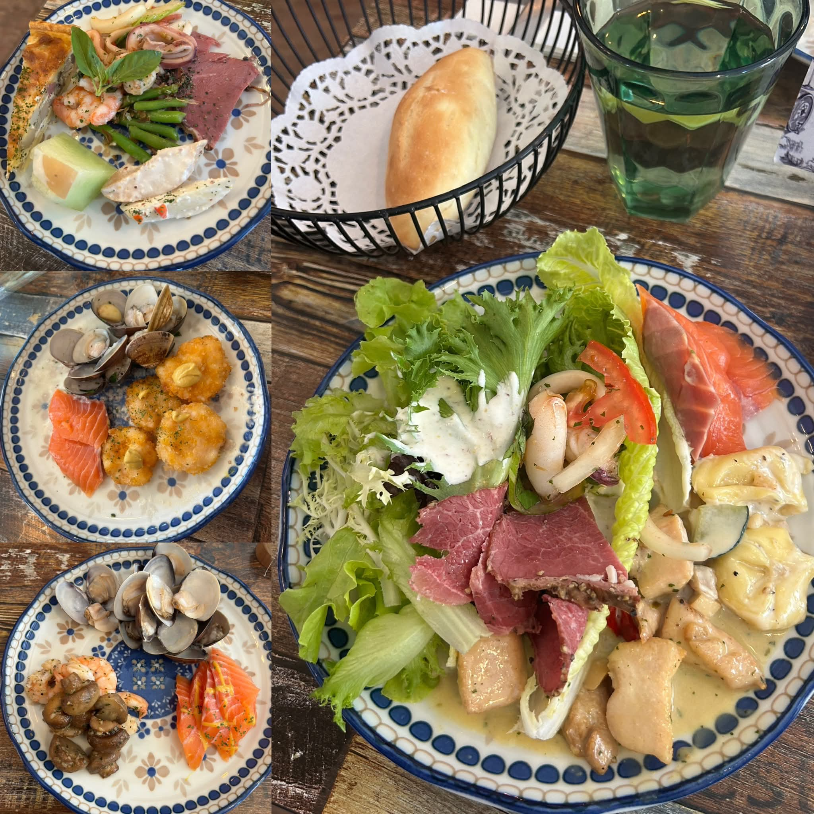
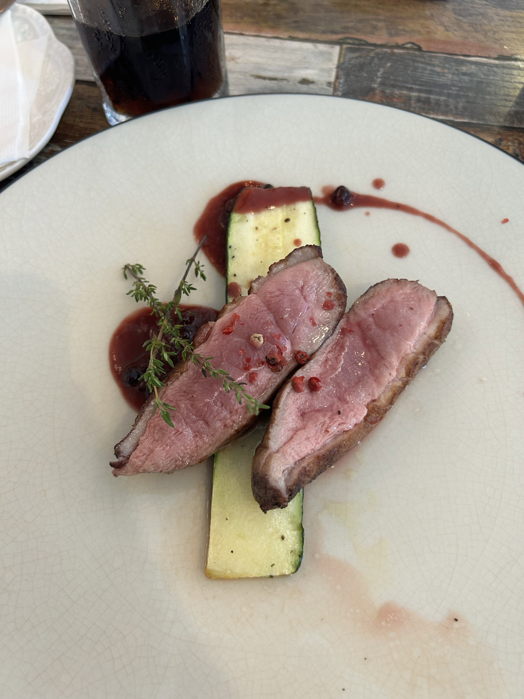
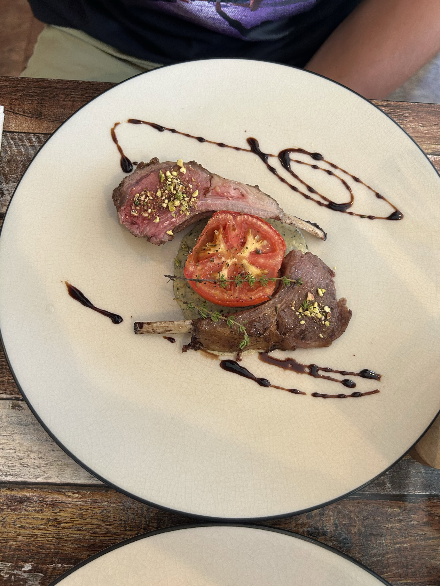
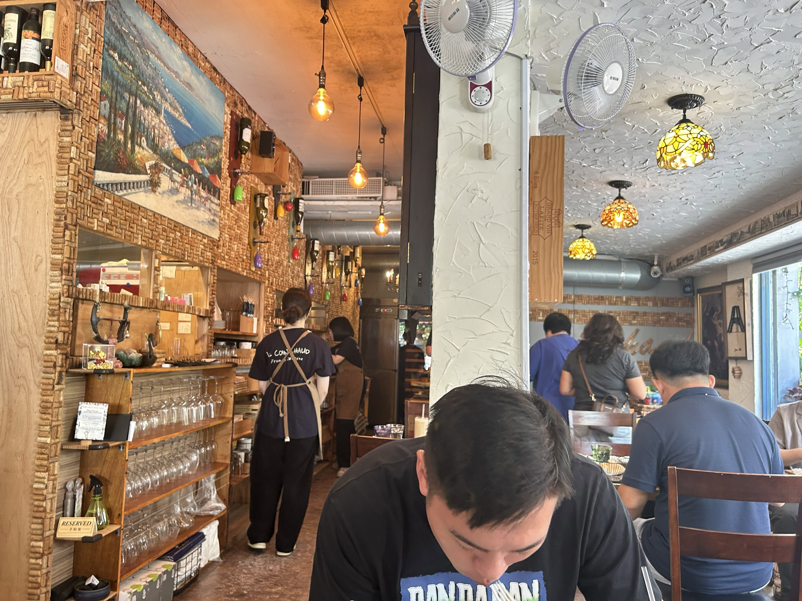

# 蘆卡樹法式小館

## 摘要

@sharon__shen 推薦江子翠附近的法式小館，認為午餐自助餐菜色豐富，但吃完自助餐後可能吃不下主菜。[Threads 原貼文](https://www.threads.com/@sharon__shen/post/DeEpmyok8dO)

## 店家資訊

- **地址**：新北市板橋區吳鳳路 15 號
- **電話**：02-2250-0278
- **店家資訊**：[蘆卡樹法式小館 Facebook](https://www.facebook.com/2073241526311249)

作者在 2026 年 10 月的[回覆](https://www.threads.com/@sharon__shen/post/DeF9g0hk5t-)中表示，自助餐在午餐時供應，套餐約 NT$1,100–1,400，純吃自助餐 NT$800。價格、菜色與供應時段可能變動，出發前請向店家確認。

## 內文或摘錄

> 江子翠可愛的法式小館
>
> 原本對法餐吃到飽（$1200）不抱期待
>
> 沒想到cp值很高 一直推出新菜
>
> 簡直是隱身在民間的飯店buffet
>
> 缺點是主菜上了吃不下～😖

作者另[補充](https://www.threads.com/@sharon__shen/post/DeEzZ_TE_Rh)餐後還有四樣水果未拍到；留言有人推薦油封鴨腿。

## 圖片

以下依主貼文輪播順序保存 4 張照片，展示自助餐拼盤、兩道主菜與店內環境；均為 JPEG，解析度依序為 2048 × 2048、3024 × 4032、3024 × 4032、4032 × 3024。

作者可見回覆為文字，未見獨立圖片或影片；其他使用者回覆的圖片未收錄。
