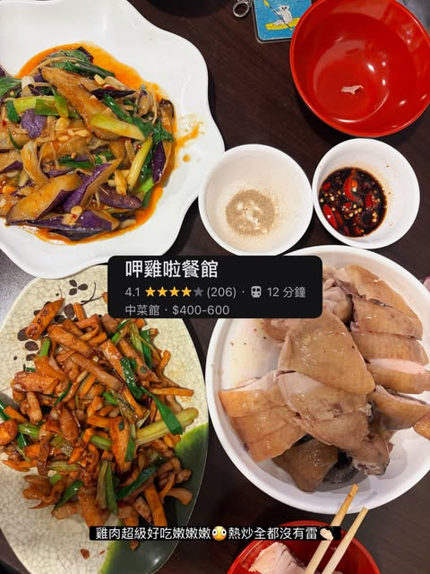
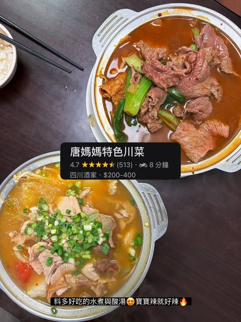
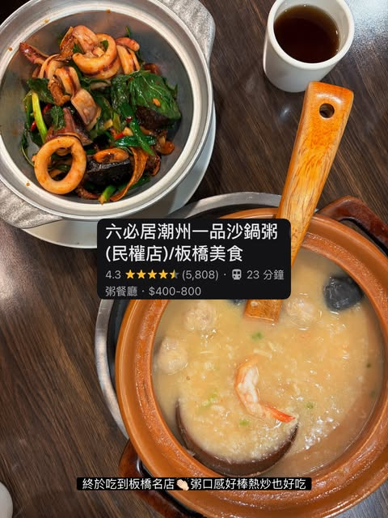
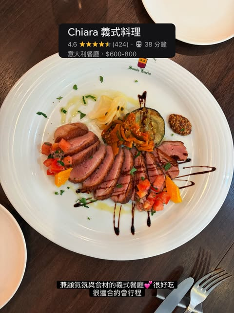
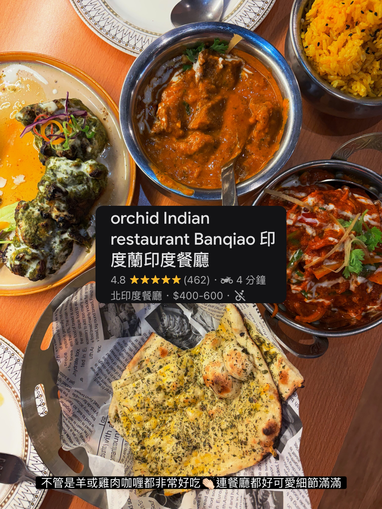
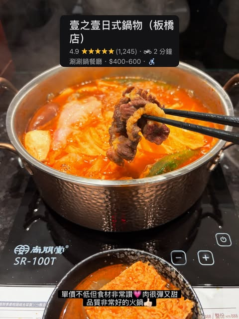
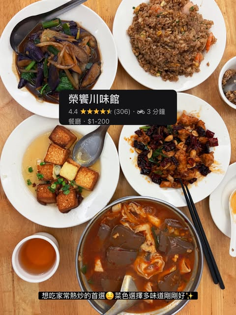

# 新埔、江子翠周邊七間餐廳

## 摘要

@bluelineikeahouse 分享七間板橋餐廳，涵蓋中式熱炒、川菜、沙鍋粥、義式料理、印度料理與鍋物。[Threads 原貼文](https://www.threads.com/@bluelineikeahouse/post/DeEB3dtmWUn)

## 內文或摘錄

> 板橋新埔江子翠七間讚店
>
> 品質好、能無限回訪的店真的很難找  
> 但這7間餐廳讓我又更離不開板橋了  
> 板橋真的是不折不扣的美食貴寶地🥳🫶🏻

### 店家清單

| 店家              | 貼文推薦重點         |
| --------------- | -------------- |
| 呷雞啦餐館           | 雞肉與熱炒          |
| 唐媽媽特色川菜         | 水煮與酸湯；作者提醒辣度較高 |
| 六必居潮州一品沙鍋粥（民權店） | 沙鍋粥與熱炒         |
| Chiara 義式料理     | 義式料理、適合約會      |
| 印度蘭印度餐廳         | 羊肉或雞肉咖哩        |
| 壹之壹日式鍋物（板橋店）    | 鍋物食材與肉品        |
| 榮饗川味館           | 家常熱炒           |

留言對部分店家評價不一，也有人指出六必居較靠近府中。地址、營業時間與價格尚未逐一核實，出發前建議再查；圖片中的評分與價位亦可能變動。

## 圖片

以下依主貼文輪播順序保存 7 張餐廳照片，每張介紹一間店；均為 JPEG，第 5 張為 3024 × 4032，其餘為 480 × 640。

目前可見留言中未見作者回覆或獨立媒體。
