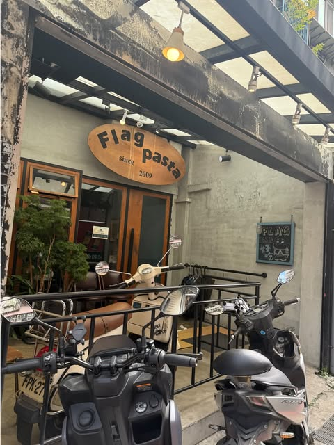
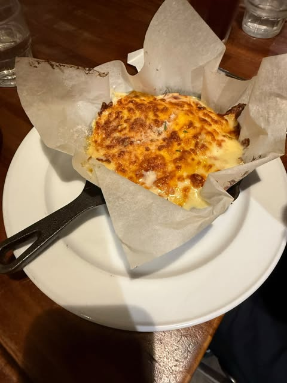
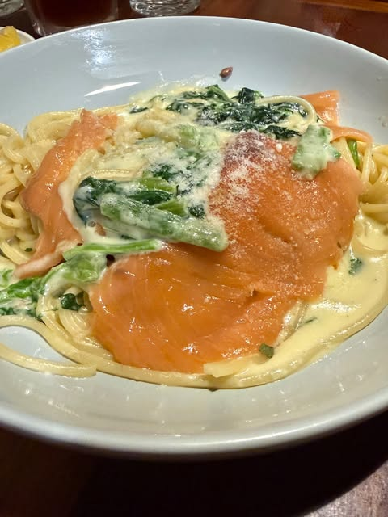

# Flag Pasta 板橋義式餐廳

## 摘要

@andyyox_ 推薦板橋的 Flag Pasta，提到義大利麵、隱藏版奶蓋紅茶，以及「花生薯條濃湯」。「板橋第一名」是作者的個人評價。[Threads 原貼文](https://www.threads.com/@andyyox_/post/DeI9RNokcZE)

## 店家資訊

- **地址**：新北市板橋區陽明街 23 巷 5 號
- **電話**：02-2255-6528
- **資料來源**：[店家線上商店](https://shop.ichefpos.com/store/ql5sQmGX/information)

營業時間與供餐內容可能變動，建議出發前確認。

## 內文或摘錄

> 板橋第一名義大利麵  
> 歡迎嚐鮮  
> 還有好喝的隱藏版奶蓋紅茶  
> 花生薯條濃湯！  
> 好吃久久吃一次

留言中有人喜歡玉米濃湯，也有人認為近年品質普通、家具較舊；意見不完全一致。

## 圖片

以下依主貼文輪播順序保存 3 張照片，分別展示兩道義大利麵與飲料；均為 JPEG，解析度依序為 480 × 640、480 × 640、640 × 742。

目前查看的留言與兩個巢狀回覆串中未見作者回覆；其他未載入的回覆仍無法確認。其他使用者回覆的媒體未收錄。

## 補充：多人聚餐推薦

- **作者**：@julie196795
- **發布**：2026-10-09
- **收集**：2026-11-25
- **來源**：[Threads 原貼文](https://www.threads.com/@julie196795/post/DeROydslAuz)

作者推薦多人聚餐時分享義大利麵、披薩等餐點，位置在新埔捷運站 1 號出口與致理科技大學附近。原文提到紅茶免費續杯，但作者在回覆中補充：以前可以續，現在不確定，建議向店家確認；也指出最後一張照片是鮭魚義大利麵。

> 這家義大利麵雖然在巷子裡面
>
> 但真的很好吃
>
> 還有紅茶免費續
>
> 建議人多聚餐的時候來吃
>
> 分享著吃都很不錯
>
> 義大利麵還有套餐 也可以點披薩或是其他系列都很讚😎
>
> 地點就在新埔捷運站1號出口
>
> 陽明街23巷5號
>
> 致理科技大學的附近

以下依此篇主貼文輪播順序保存 4 張照片，分別為店面、燉飯米介紹牌、焗烤料理與鮭魚義大利麵；均為 480 × 640 JPEG。

此篇目前可見的作者回覆未見獨立圖片或影片；其他使用者回覆的媒體未收錄。
