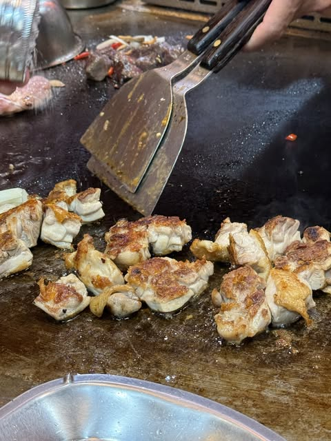
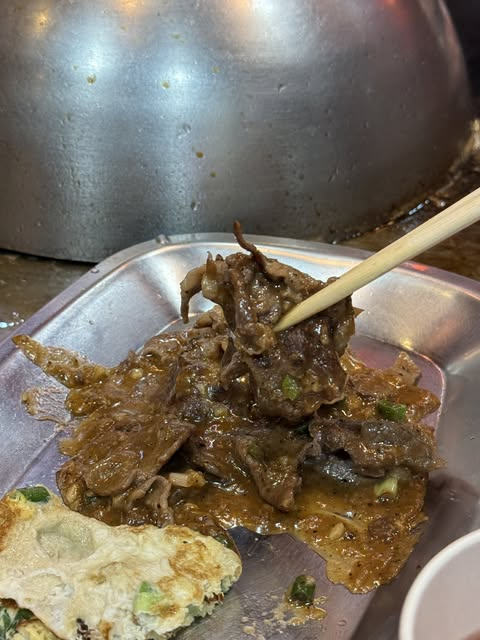
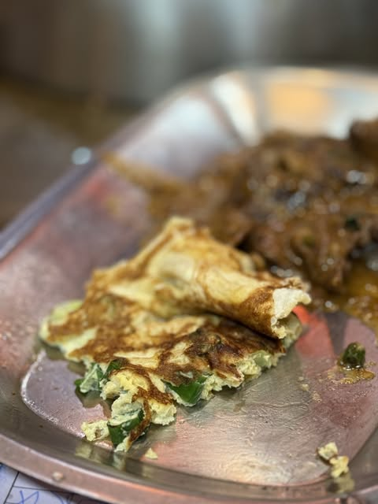
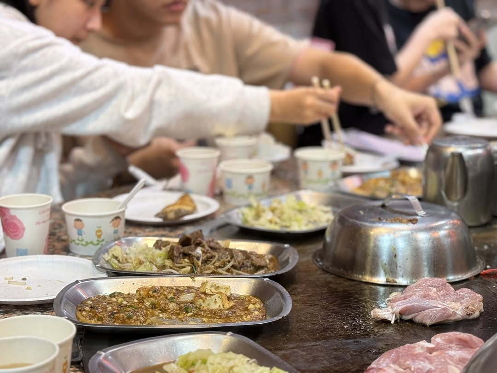
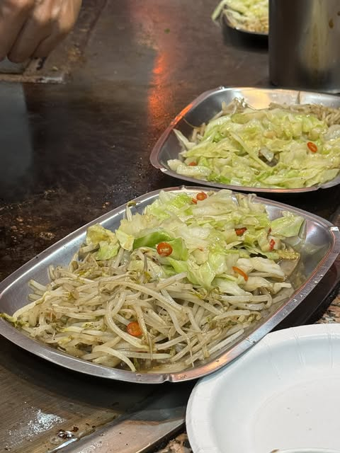
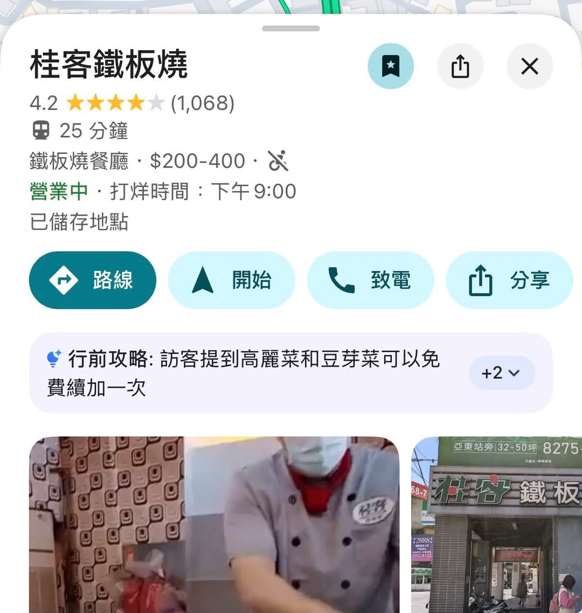

# 桂客鐵板燒

## 摘要

@_cyw_715 推薦板橋一家平價鐵板燒，稱餐點好吃、配菜可以續。作者後續貼文附上的 Google 地圖截圖顯示店名為桂客鐵板燒，並說要把它存為「板橋鐵板燒第一順位」。[Threads 主貼文](https://www.threads.com/@_cyw_715/post/Df6_JQHH31K) · [作者後續貼文](https://www.threads.com/@_cyw_715/post/Df6_TERHyGW)

截圖當時顯示 Google 地圖評分 4.2（1,068 則評論）及價位約 NT$200–400；評分與價位會變動，僅代表截圖資訊，出發前請再確認。

## 內文或摘錄

> 板橋真的是美食天堂！  
> 是好吃的平價鐵板燒脆沒在騙😻😻😻  
> 而且菜還可以續，太佛

留言評價不一：有人表示吃過但覺得不優；另有網友稱蚵仔大顆，也有人覺得員工熱情，但用餐空間和食材仍有改善空間。

## 其他使用者回覆

@ztsc09187575970 另外推薦**上富鐵板燒（板橋店）**，表示從小學吃到成年，店家已由第二代接手；他覺得價格稍高，但份量足、醬料下飯。作者回覆「好欸存！」。這是另一家店，與桂客鐵板燒分開記錄；相關營業資訊尚未核實。[推薦留言串](https://www.threads.com/@_cyw_715/post/Df7Dz4FHwXH)

## 圖片

以下依主貼文輪播順序保存 5 張鐵板料理照片，展示鐵板肉類、肉片與蛋料理、用餐情形及蔬菜；前 3 張與第 5 張為 JPEG 480 × 640，第 4 張為 JPEG 1080 × 810。

作者後續貼文另附 1 張 Google 地圖桂客鐵板燒資訊截圖，為 JPEG 1080 × 1138。

目前可見主貼文及作者後續貼文未見影片。上富鐵板燒留言中的第三方地圖卡未收錄為附件。
