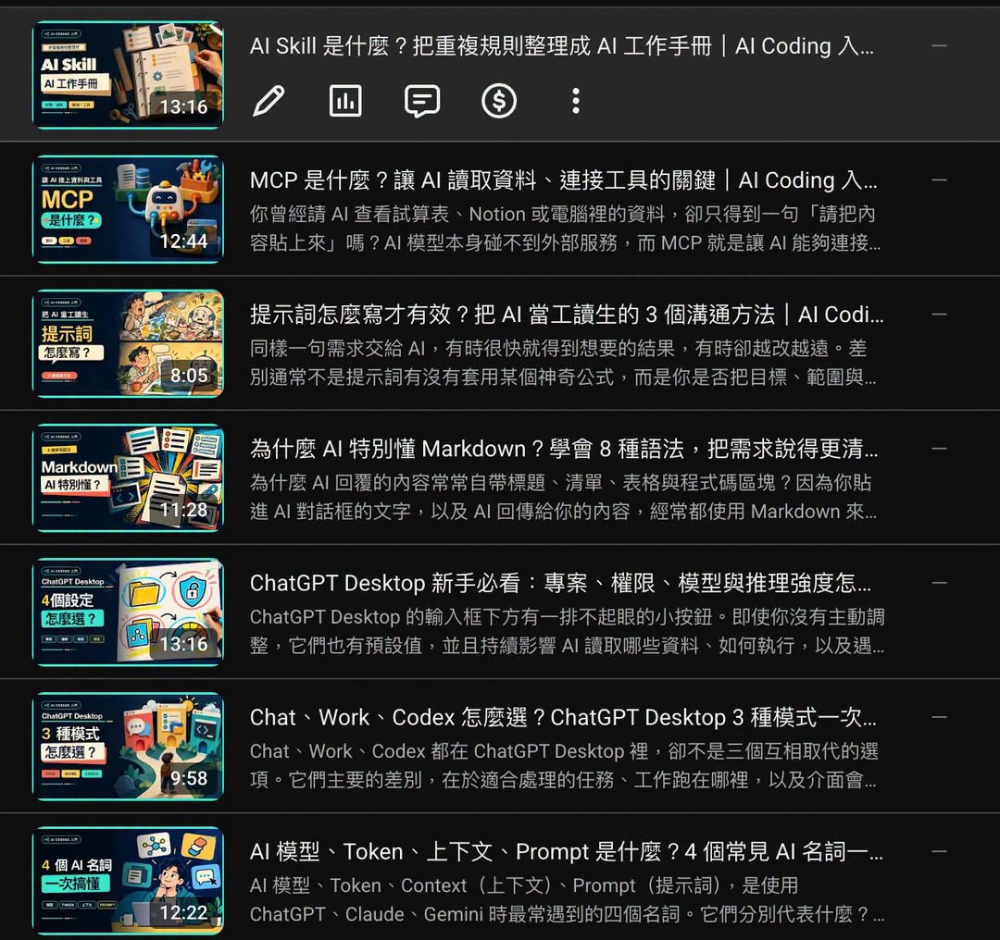

# 卡斯伯 AI Coding 新手入門：iThome 鐵人賽系列

## 摘要

卡斯伯分享參加 iThome 鐵人賽時整理的 AI Coding 入門系列，目標是讓新手理解常見 AI 工具與開發概念，並逐步把 AI 帶進實際開發流程。[Facebook 原貼文](https://www.facebook.com/story.php?story_fbid=1510758474407897&id=100064212751044)

貼文當時列出的主題包括 AI Skill、MCP、Prompt、Markdown、ChatGPT Desktop 的專案與權限設定、Chat／Work／Codex 模式，以及 Model、Token、Context 等常見名詞。作者表示同系列也整理成影片與動態簡報。

## 系列資源

- [鐵人賽 30 篇文章總覽](https://book.casper.tw/it2026/)
- [Day 1：AI Coding 是什麼？不會寫程式也能開始嗎？](https://book.casper.tw/it2026/what-is-ai-coding)
- [系列影片](https://youtu.be/3YgmPjYLB7w)
- [互動式動態簡報](https://www.casper.tw/2026-interactive-presentation/)

依收集時的系列總覽，內容從 AI 模型、Chat、Agent、Harness、MCP 與 Skill，延伸至網站前後端、API、終端機、Git／GitHub、雲端部署、開發安全，最後以 AI 製作小工具作結。可依總覽順序學習；實際文章及多媒體內容以原站為準。

## 貼文媒體與留言

- 主貼文附 1 張圖片（JPEG，1080 × 1016），是系列影片清單截圖，展示 AI Skill、MCP、Prompt、Markdown、ChatGPT Desktop 與 AI 名詞等影片項目；未見主貼文附影片。
- 作者留言提供文章、系列影片與動態簡報連結；這些是外部資源，不是貼文附件。本筆記只保存主貼文圖片，不下載留言連結中的影片或簡報。
- 可見其他留言為簡短致謝或回饋，沒有額外補充資源。

