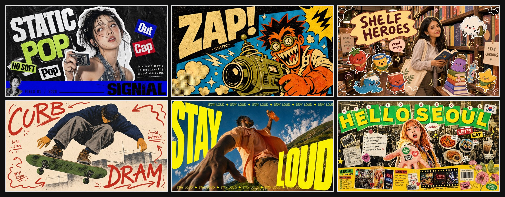
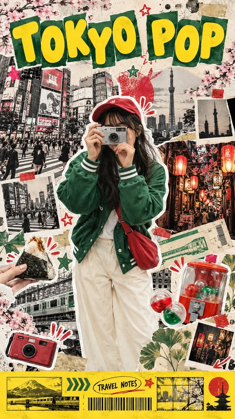
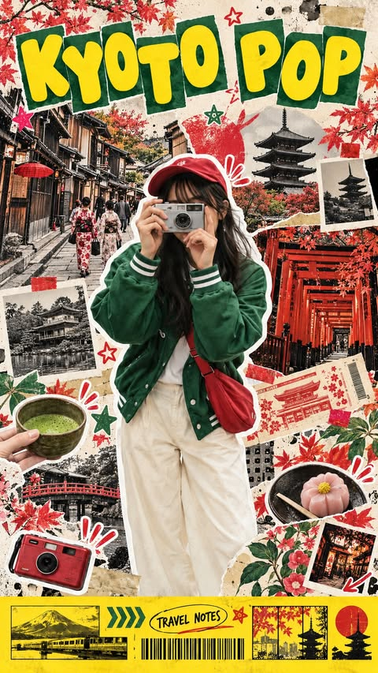
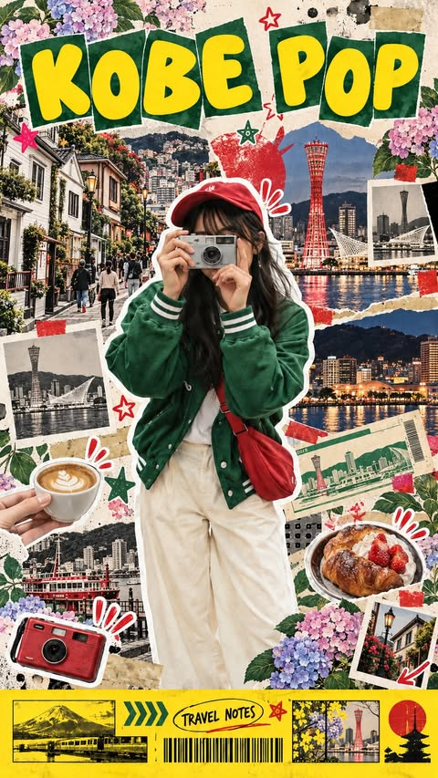

# AI Visual Prompt Cookbook：可重複使用的視覺規格庫

@techtalk.ai.tech.web 介紹 AI Visual Prompt Cookbook，一個以 `style.json` 保存可重複使用視覺規格的專案。規格可包含色彩、字體風格、構圖、鏡頭距離、材質、光線，以及應保留和應避免的元素。原貼文發布時提到已收錄超過 150 套規格。[Threads 原貼文](https://www.threads.com/@techtalk.ai.tech.web/post/DeJyaUgAjjB)

## 工具與資源

- [AI Visual Prompt Cookbook 專案與使用說明](https://github.com/VigoZhao/AI-Visual-Prompt-Cookbook)
- [Tokyo Kawaii Travel Collage Poster 的 style.json](https://github.com/VigoZhao/AI-Visual-Prompt-Cookbook/blob/main/styles/tokyo-kawaii-travel-collage-poster-style/style.json)

## 主貼文附圖

主貼文附有一張橫向拼圖，並排展示六種風格。

## 作者回覆的三張示範圖

作者用同一套 Tokyo Kawaii Travel Collage Poster 規格製作東京、京都和神戶三張海報。[Threads 作者回覆](https://www.threads.com/@techtalk.ai.tech.web/post/DeJyd2NAsoh)

## 提示詞重點

- 用 `style.json` 固定一組視覺規則，換主題時可以沿用構圖、色彩和風格。
- 從 `environment_variables` 找出可替換欄位，或從 `examples[*].values` 選一個範例開始改。可將完整 JSON 貼入能讀取結構化提示詞的工具，產生最終提示詞後交給圖像模型。

## 自己試作時

1. 複製 Tokyo Kawaii Travel Collage Poster 的 `style.json`，選一個範例當底稿。
2. 先生成一座城市的海報，再換城市、景點與小道具，並更新對應的地名文字。沿用同一個主角、服裝、漫畫對話框、貼紙密度、色彩和版面規則。
3. 把成品並排比較，確認主角與整體版面維持一致，並核對各城市的地名、地標和在地道具。
