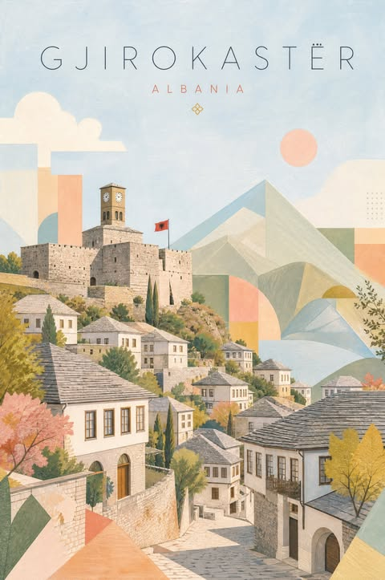
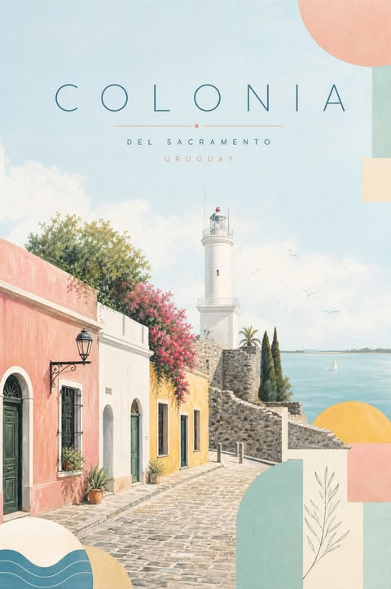
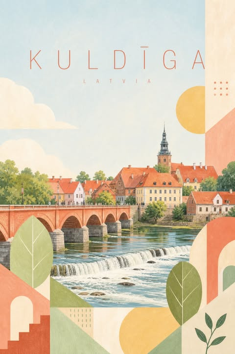
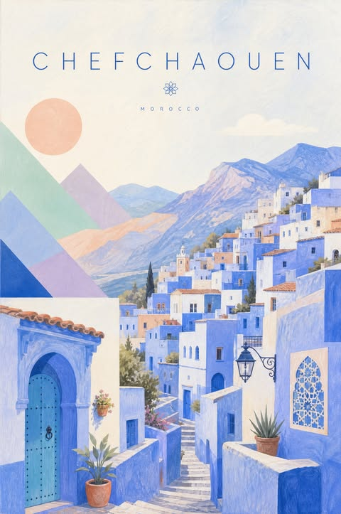
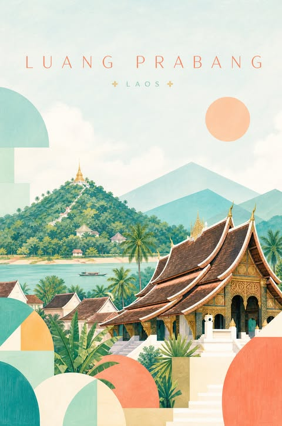

# Gjirokastër 旅遊藝術海報 AI 提示詞範例

smartaitools6 分享一個用於產製阿爾巴尼亞 Gjirokastër 旅遊藝術海報的英文提示詞，採 2:3 直式比例，融合 Gjirokastër Castle、石屋頂房舍、丘陵與山嶽，比例為 70% 地標與 30% 幾何風格，並搭配粉藍、鼠尾草綠、杏色、腮紅、奶油黃、象牙色與淺陶土色，帶有細緻 gouache 質感，呈現明亮、通透、精緻的斯堪的納維亞編輯風格。[Threads 原貼文](https://www.threads.com/@smartaitools6/post/DeJ12uhEaeI)

貼文中的輪播圖集展示五座城市的海報，以下範例圖為同一貼文中的城市海報示範（採用相同構圖與風格模板）。由於登入限制，第一張 Gjirokastër 主圖暫時無法取得，下方僅保留可取得的四張輪播圖片。

## 作者的英文提示詞

```text
Create a 2:3 travel art poster of Gjirokastër, Albania, featuring Gjirokastër Castle, stone-roofed houses, hills, and mountains in a 70% landmark, 30% geometric style. Add "GJIROKASTËR" in thin spaced type. Use powder blue, sage, apricot, blush, butter yellow, ivory, and light terracotta, with subtle gouache texture. Bright, airy, refined, Scandinavian editorial style.
```

工具連結：[picwish.com/ai-photo-maker](https://picwish.com/ai-photo-maker)

## 作者示範圖







## 提示詞重點

- **構圖比例**：2:3 直式旅遊海報。
- **主題內容**：Gjirokastër Castle、石屋頂房舍、丘陵、山嶽。
- **風格比例**：70% 地標 + 30% 幾何風格。
- **文字處理**："GJIROKASTËR" 採細字重、加寬字距排版。
- **色調**：粉藍、鼠尾草綠、杏色、腮紅、奶油黃、象牙色、淺陶土色。
- **質感**：細緻 gouache 質感。
- **整體風格**：明亮、通透、精緻，斯堪的納維亞編輯風格。

## 自己試作時

1. **複製提示詞**：將上方英文提示詞貼入 AI 產圖工具。
2. **選擇工具**：貼文提供的工具為 picwish AI Photo Maker，或可換用其他支援自訂提示詞的產圖工具。
3. **調整參數**：依需求調整比例、色調與文字內容，核對產出的 Gjirokastër 地標特徵是否保留，並檢查 GJIROKASTËR 拼字與變音符號（Ë）是否正確顯示。
