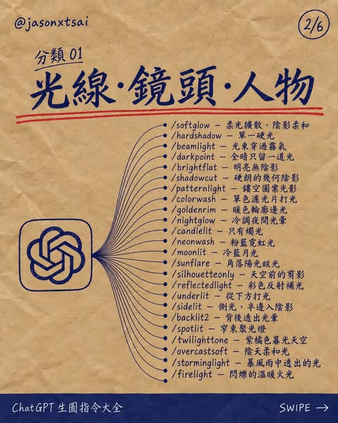
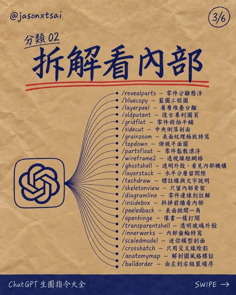
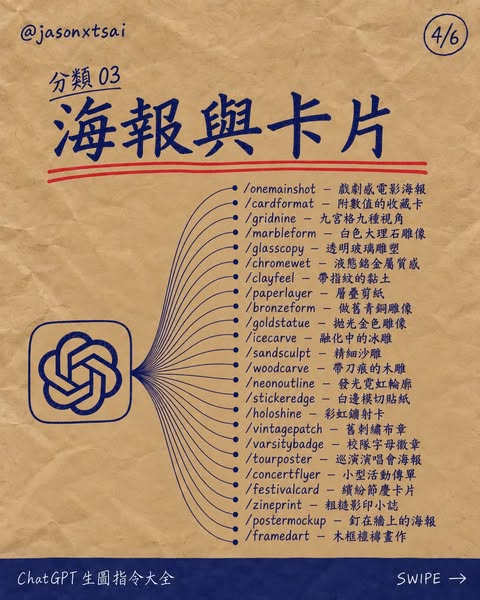
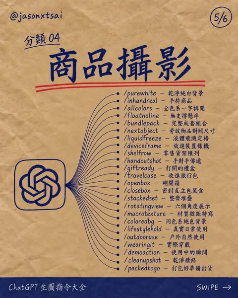
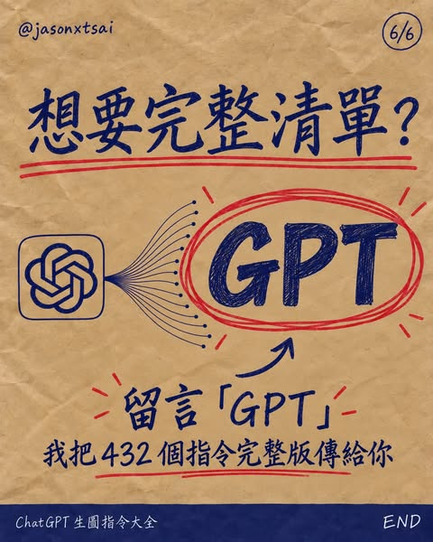

# ChatGPT 生圖指令大全

## 摘要

@jasonxtsai 整理了 432 個生圖指令、18 個分類，涵蓋光線、商品攝影、插畫、構圖與修圖。[Threads 原貼文](https://www.threads.com/@jasonxtsai/post/DeOx5ugj2Bd)

## 內文或摘錄

> 我把 ChatGPT 生圖常用的風格，整理成 432 個斜線指令。  
> 我自己用最多次的是/purewhite，一句話把商品照背景變乾淨。  
> 完整版要的話，留言「GPT」。

作者在[回覆](https://www.threads.com/@jasonxtsai/post/DePG8tmD4ov)中已公開清單連結，無需留言索取：

- [ChatGPT 生圖指令大全網頁](https://jasonxtsai.github.io/pages/jason/chatgpt-image-commands.html)
- [Markdown 指令清單](https://jasonxtsai.github.io/pages/jason/files/chatgpt-image-commands.md)

### 使用方式

**這些斜線指令不是 ChatGPT 內建功能。** 作者說明可以直接複製清單中的英文「展開句」，或先將清單提供給 AI 作為查表依據，再要求它展開指令；實際效果仍需檢查。

| 指令 | 清單中的效果 | 英文展開句 |
| --- | --- | --- |
| `/purewhite` | 乾淨純白商品背景 | product on a clean pure white seamless background, e-commerce style |
| `/softglow` | 柔光擴散、陰影柔和 | soft diffused lighting, gentle shadows, even tones |
| `/revealparts` | 零件分離懸浮 | exploded view, components floating apart in order |

自己試作時，可先選幾項不衝突的效果，搭配主體與畫面比例；若使用人物或商品照片，也應確認照片使用權限。

## 圖片

以下依主貼文輪播順序保存 6 張圖片，內容是指令大全的封面、分類範例與取得方式；均為 JPEG、480 × 600。

作者可見回覆包含清單連結與文字，連結卡片預覽未收錄；部分回覆尚未展開。
