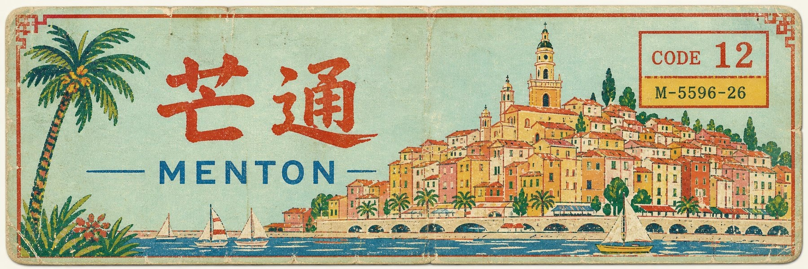
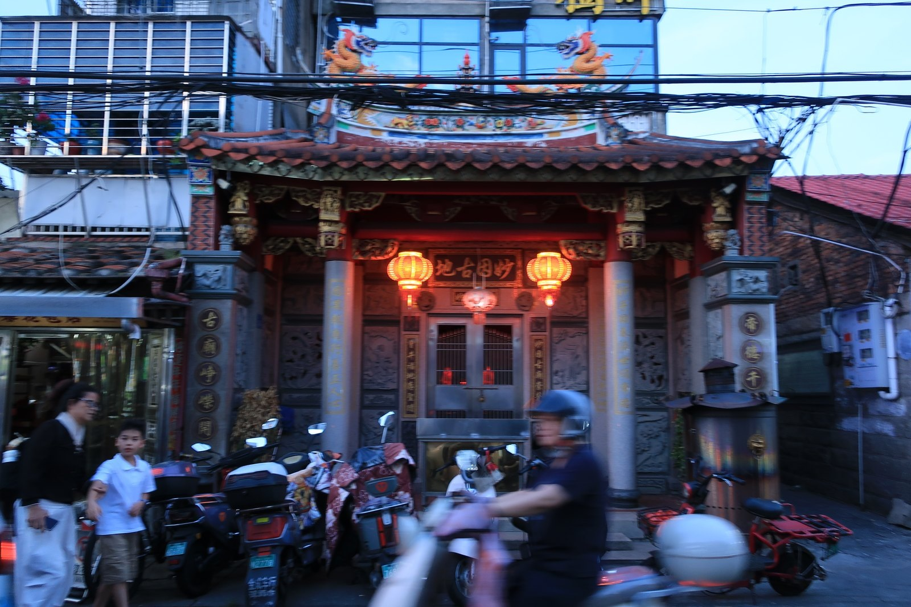
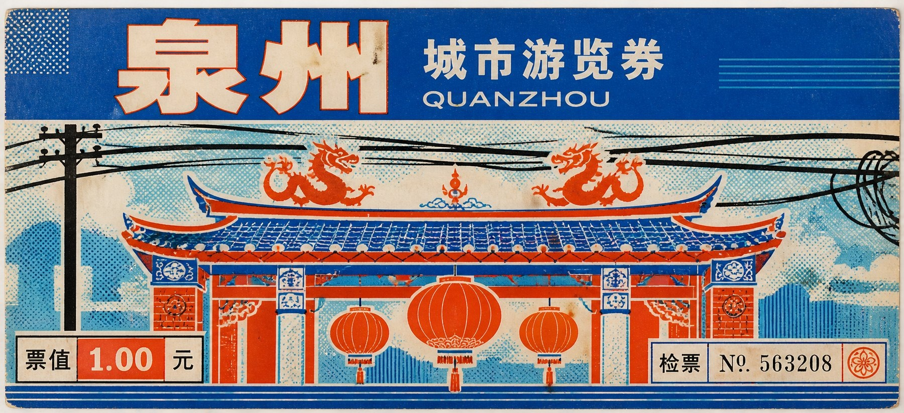

# 把照片變成復古紀念門票

## 摘要

@ammiamia_ 分享 `vintage-travel-ticket`：將旅行、街景、風景、美食或日常照片重新繪製成 20 世紀中後期風格的中文老式門票，而非只套用復古濾鏡。[Threads 原貼文](https://www.threads.com/@ammiamia_/post/DeOk8xtmzmB)

## 內文或摘錄

作者指出，Skill 會重新設計票券比例、版式、紙張、套色、插畫、字體和印刷磨損，每次生成一張獨立成品。

### 專案與使用方式

- **Skill 作者**：hongfamonvAI
- [GitHub 專案](https://github.com/hongfamonvAI/vintage-travel-ticket) · [完整 Skill 規則](https://github.com/hongfamonvAI/vintage-travel-ticket/blob/main/SKILL.md)
- [Threads 作者說明](https://www.threads.com/@ammiamia_/post/DeOk9dUm9yi)

作者提供的 Codex 安裝方式：

```bash
git clone https://github.com/hongfamonvAI/vintage-travel-ticket.git \
  ~/.codex/skills/vintage-travel-ticket
```

上傳照片後可說「做成老式門票」；這是觸發語句，詳細生成規則在專案的 `SKILL.md` 與參考文件中。此筆記僅記錄用法，未安裝或執行該 Skill。

### 工作重點

- 可提供地點、景點或美食名稱，並選擇提供姓名與紀念日期；生成後仍需核對名稱與文字。
- 從 16 類票券結構原型選擇完整設計，再協調比例、版式、紙張、插畫、字體與做舊。
- 重新繪製照片主題，不保留原攝影構圖；每次交付一張獨立門票。
- 票面結合票券結構與票務資訊，例如分欄、票號、票價或檢票欄位。

使用前應自行檢查專案內容與授權，並確認上傳照片的使用權及隱私設定。

## 圖片

主貼文有一張芒通復古門票示範，JPEG、1800 × 600：



作者[後續回覆](https://www.threads.com/@ammiamia_/post/DeOk95Xm0V8)另有兩張圖片，依序為泉州廟宇街景原照與復古票券成品：





兩張回覆圖片均為 JPEG，解析度依序為 1600 × 1067、1800 × 823。主貼文與作者回覆均未見影片。
