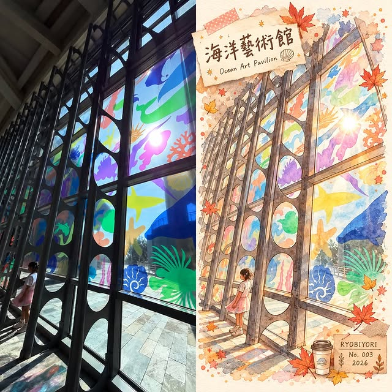
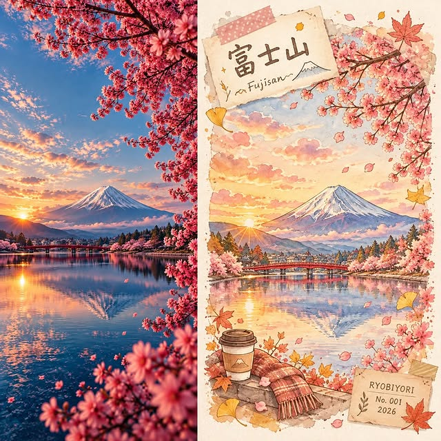
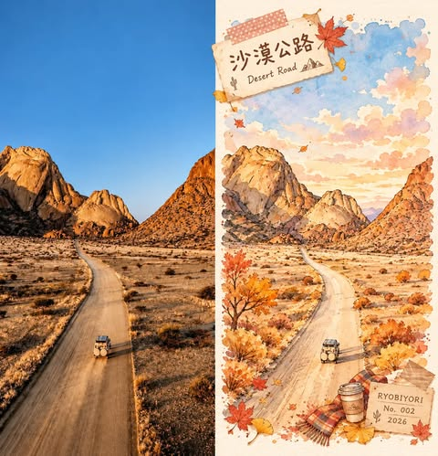
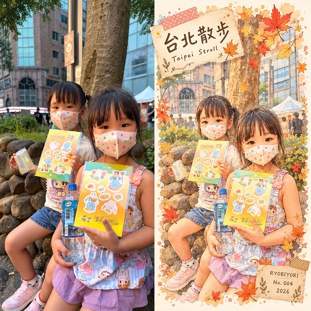

# 照片變成秋日手帳水彩

## 摘要

@maman2sweet 分享將照片左右各半對照的提示詞：左側保留原照，右側轉成暖色水彩手帳插畫，搭配地名貼紙與秋日裝飾。[Threads 原貼文](https://www.threads.com/@maman2sweet/post/DeQYuyXk1CB)

## 內文或摘錄

主貼文：「Try try prompt」

### 作者原始提示詞

[Threads 作者回覆](https://www.threads.com/@maman2sweet/post/DeQY09nE2qh)

```text
【構圖】
採用左右分割構圖,比例約 1:1。

【左側】
完整保留真實照片原貌,維持自然的色彩與光線。
不得加入任何文字標籤或設計元素,作為對照組。

【右側】
將建築轉換為「秋天手帳水彩」風格。
所有文字與標籤設計都完整配置在這一側。

■ 繪畫技法
・以透明水彩暈染上色,色塊邊緣有自然的水痕與
濕染渲開效果,局部留白,讓紙張透光
・以深咖啡色或焦糖色的細線筆勾勒輪廓,
線條纖細、略帶手繪的抖動感,不要過度工整
・陰影以淡淡的疊色表現,不使用黑色
・少量水彩飛濺小點與淡淡的鹽粒紋理

■ 秋日配色(柔和低飽和,不使用螢光色)
・焦糖奶茶棕、霧玫瑰粉、杏橘色、
奶油黃、少量楓葉紅,暗部用淡灰紫點綴
・整體像午後柔光,溫暖又帶點粉嫩

■ 造型與場景
・建築簡化為圓潤可愛的造型,邊角柔和,
窗戶透出暖黃燈光,屋頂可點綴落葉
・建築旁有一棵暈染成粉橘、杏黃色的樹,
風中飄落少量楓葉與銀杏葉
・地面散落落葉,可加入一件小物:
熱拿鐵、針織圍巾、小南瓜或橡實(擇一至兩項即可)
・天空為淡淡的杏粉到奶油黃漸層暈染,
可有幾朵水彩雲與小小的圓點裝飾

■ 手帳裝飾・畫面邊角貼 1~2 條和紙膠帶(牛皮紙色與霧粉色),
以及一片壓花風的小楓葉,像貼在手帳上
・可加入手寫風的小箭頭或小星星線稿點綴

■ 招牌文字
・若照片中有招牌文字,須忠實呈現實際內容,
以手寫或細線筆字樣表現

■ 地名標籤(右側插圖的左上方)
・像手帳貼紙:奶油色紙片,邊緣略帶水彩暈染,
稍微傾斜,貼上和紙膠帶固定
・主標題:【填入地名】(較大,圓潤手寫風日文字體,深棕色)
・副標題:【例:Osaka】(較小,英文手寫體,字距稍寬)
・可與樹梢或屋頂邊緣稍微重疊

■ RYOBIYORI 標籤(右側插圖的右下方)
・低調的牛皮紙色小標籤,深棕色細字
・標示:RYOBIYORI(固定)/ No.【編號】/ 【年份】

【務必遵守:文字內容規則】
以上文字內容為最終定案。AI 不得擅自更改為其他地名,
也不得自行聯想生成。所有文字元素都必須配置在右側
插圖畫面內,左側照片須保持完全乾淨。

【背景】
暖白色的水彩紙紋理(淡淡的粗紋),
讓整件作品像畫在一本手帳上的插圖。

【整體印象】
溫柔、療癒、帶點咖啡廳的午後氣息。
像秋天翻開的一頁手帳,柔軟又讓人想收藏。
```

### 提示詞重點

- 使用透明水彩、細線輪廓與低飽和秋日配色。
- 右側加入地名、英文副標題及固定的 `RYOBIYORI` 標籤；地名、編號和年份需自行填入。
- 原提示詞以建築為主，但示範也包含風景與人物；可依照片調整。

### 自己試作時

上傳照片並填入地名、編號和年份，生成後核對地名與招牌文字。使用人物、尤其兒童照片時，應先確認同意與隱私設定。

## 圖片

以下依主貼文輪播順序保存 4 張示範圖，展示左側原照與右側秋日水彩手帳的對照；均為 JPEG，解析度依序為 640 × 640、640 × 640、480 × 499、640 × 640。









作者可見回覆為文字提示詞，未見獨立圖片或影片；其他使用者回覆的圖片未收錄。
