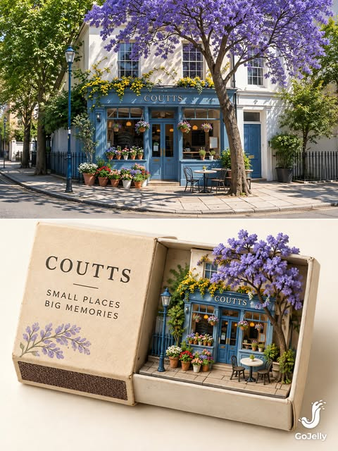
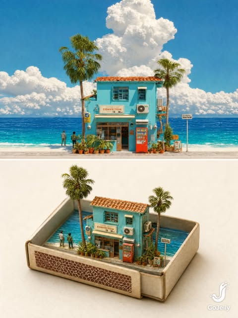
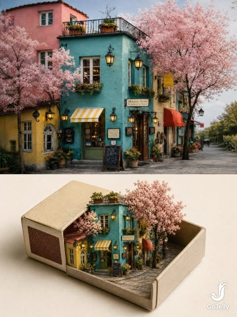
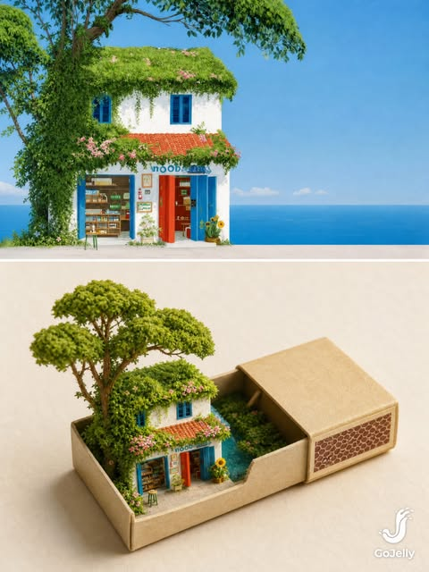
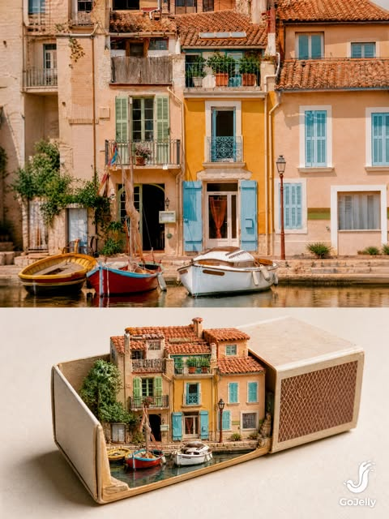

# 把旅遊回憶裝進火柴盒

## 摘要

@grace.hollin192026 分享將每張照片獨立製成 3:4 直式海報的提示詞：上半部保留原照，下半部把場景濃縮成放在半開火柴盒中的手作微縮世界。[Threads 原貼文](https://www.threads.com/@grace.hollin192026/post/DeTnswUk6FG)

## 內文或摘錄

> Wish I could keep every trip in my pocket. 📦✨  
> So I turned my favorite travel photo into a tiny world inside a matchbox.  
> prompt below ⬇️⬇️⬇️

### 作者英文提示詞

[Threads 作者提示詞回覆](https://www.threads.com/@grace.hollin192026/post/DeTntbPk_ey)

```text
Source & Format: Use each uploaded photograph as the only visual source.Create one independent premium editorial poster per photo.Output each separately;never merge multiple images.Use a strict vertical 3:4 canvas divided into two exactly equal horizontal sections.The upper and lower halves must each occupy precisely 50% of the total height.The concept is “a real moment transformed into a tiny world inside an open matchbox.”

Upper Half·Original Photograph: Preserve the uploaded photograph faithfully,including subject identity,number,pose,facial or structural features,spatial relationships,perspective,environment,natural lighting,and original colors.Apply only subtle editorial color grading and extremely light film grain.Allow minimal cropping or seamless background extension when necessary.Never distort,mirror,replace,move,or redesign the main subject.The upper half must remain authentic photography,without text,illustration,or decorative overlays.

Lower Half·Matchbox Memory World: Reimagine the same photograph as one handcrafted miniature scene contained inside a partially opened sliding matchbox.Place the matchbox on a clean warm-white or pale ivory paper surface.The box must be a recognizable physical object with an outer cardboard sleeve and an inner tray pulled outward,exposing its miniature world.The scene should appear carefully built inside the open tray,with selected elements rising naturally above the box edges.The result must feel like a real collectible object photographed in a design studio,not a flat illustration or digitally pasted scene.

Matchbox Structure: Use a classic rectangular sliding matchbox with believable folded cardboard construction,visible paper thickness,slightly worn corners,fine cardboard fibers,and subtle handmade imperfections.The inner drawer extends approximately 45%–65% from its sleeve.The opening faces the viewer at a gentle three-quarter angle,allowing the interior landscape,front edge,and side thickness to remain visible.The box should occupy approximately 58%–72% of the lower-section width,large enough for the miniature details to remain recognizable.Avoid making the box so small that the scene becomes unreadable.

Scene Interpretation: First identify the photograph's most memorable subject,action,landmark,or spatial relationship.Then compress these essential elements into one coherent miniature environment.Preserve the original narrative rather than mechanically copying the full background.A landscape may become a miniature valley inside the box;a street photograph may become a tiny road with recognizable buildings;a coastal scene may contain miniature waves,boats,and shoreline;a portrait or pet photo may become a small figure surrounded by two or three meaningful environmental details.Keep the source subject's distinctive silhouette,direction,pose,and relationships clearly recognizable.Remove insignificant background clutter.

Miniature Construction: Build the scene using physically believable handcrafted materials:painted cardboard,paper pulp,miniature plaster,thin wood,modeling clay,fine wire,soft flocking,and small translucent elements where appropriate.Architecture should have dimensional walls and roofs.Landscapes should show layered terrain.Roads should follow the original scene direction.Water may use shallow translucent resin or thin reflective material.Trees and plants should appear as delicate handmade clusters.People and animals should become small sculpted figures preserving their original identity cues,quantity,pose,and interaction,without requiring realistic facial detail.

Emerging World Effect: The most recognizable element may rise slightly beyond the matchbox opening,creating a sense that the memory is too large to remain inside its container.For example,a tree may extend above the rim,a building roof may rise beyond the tray,or a winding road may continue toward the front edge.This extension must remain physically connected to the miniature world and stay entirely inside the lower poster section.Keep the effect restrained:the matchbox remains the main structural container,not a platform for an oversized floating landscape.

Composition & Scale: Keep one dominant miniature scene rather than many disconnected objects.Adapt the box orientation and internal arrangement to the original photograph's visual direction.Preserve recognizable subject relationships while freely simplifying background scale.The miniature world should feel compressed and intimate,with purposeful variation between larger main elements and tiny supporting details.Leave generous negative space around the matchbox.Do not fill the entire lower half with scenery,decorations,or unrelated objects.

Materials & Physical Realism: Emphasize folded cardboard edges,visible tray walls,slight paper warping,matte painted surfaces,small construction seams,hand-shaped terrain,subtle tool marks,and realistic contact shadows.All components must feel carefully assembled at a genuinely miniature scale.Include natural variations in texture without excessive weathering.Avoid glossy plastic figurines,perfectly smooth CGI surfaces,or oversized toy-like proportions.

Lighting: Use soft directional studio light from the upper right,with gentle highlights on the cardboard edges and miniature structures.The box casts a coherent soft shadow onto the pale paper beneath it.Small objects inside the tray produce delicate localized shadows,reinforcing real physical depth.The interior must remain bright enough for the miniature scene to be clearly visible.Avoid dark cavities,harsh spotlighting,or artificial glowing effects.

Color Palette: Extract the main colors directly from the uploaded photograph and reinterpret them as carefully painted miniature materials.Preserve the source image's most recognizable color relationships while slightly softening saturation.Allow one or two stronger signature colors to anchor the composition.The matchbox sleeve should use natural kraft,cream,muted gray,or another subtle paper tone compatible with the photograph.Avoid arbitrary pastel recoloring or unrelated decorative colors.

Editorial Finish: The final poster should feel like a contemporary travel-art publication combining authentic photography and a beautifully crafted pocket-sized memory object.The matchbox should appear tangible,ingenious,and collectible,with enough detail to reward closer inspection but a clear silhouette that works immediately at social-media thumbnail size.The viewer should instantly understand that the real scene above has been transformed into a tiny world that can be carried in a matchbox.

Negative: No merged photos,no unequal halves,no generic open box,no closed matchbox,no unrelated miniature scenery,no full-scale landscape outside the container,no excessive tiny objects,no floating structures,no oversized figures,no toy-store aesthetic,no plastic CGI,no flat cutout illustration,no random decorative stickers,no crowded lower background,no distorted anatomy,no inconsistent shadows,no extra people,no logos,no watermark,no UI,and no gibberish text.
```

### 提示詞重點

- 上下各半，保留原照的主體、構圖和色彩。
- 火柴盒保留紙板外殼與抽屜結構，從照片提取最有辨識度的場景。
- 使用紙板、黏土、木材等手作材質，搭配柔和光線與陰影。
- 避免無關景物、漂浮結構、塑膠感及過度擁擠。

### 資源

作者另在[回覆](https://www.threads.com/@grace.hollin192026/post/DeTnt9dk-D8)附上 [GoJelly 靈感頁](https://gojelly.ai/zh-tw/inspiration/matchbox-memories-gpt-image-20--cmv242fua0tc1nw01wmi3ppan)。示範圖帶有 GoJelly 標誌，雖然提示詞要求不要浮水印。

## 圖片

以下依主貼文輪播順序保存 5 張示範圖，展示原照與火柴盒微縮場景的上下對照；均為 JPEG、480 × 640。











作者可見回覆包含文字提示詞與 GoJelly 連結卡片，未見獨立圖片或影片；卡片預覽及其他使用者回覆的圖片未收錄。
