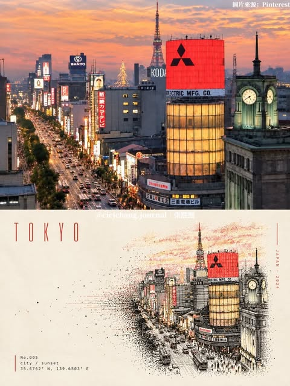
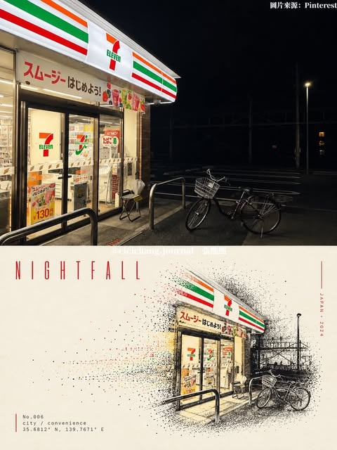
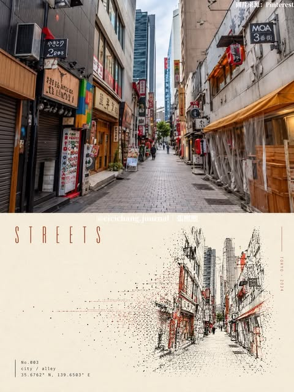
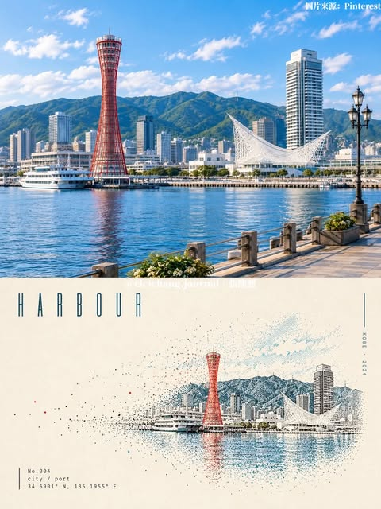

# 照片變成極簡點描海報

## 摘要

@cicichang.journal 分享將照片製成 3:4 直式編輯風海報的提示詞：上方 55% 保留原照，下方 45% 以細點、線條和大量留白重新描繪主體。[Threads 原貼文](https://www.threads.com/@cicichang.journal/post/DeTBcUfn3xL)

## 內文或摘錄

主貼文：「有點大人味的感覺 簡約時尚😍😍😍(附prompt)」

### 作者英文提示詞

[Threads 作者回覆](https://www.threads.com/@cicichang.journal/post/DeTBcJ2n9m0)

```text
Turn the uploaded photo into a 3:4 vertical editorial poster with two stacked panels.

Top 55%: the original photo, full-bleed, unchanged, no text.

Bottom 45%: off-white grainy paper (matte black if the photo is dark). Redraw the photo's one main subject small, as a fine ink stipple illustration in black plus one accent color sampled from the photo, dissolving into thousands of fine dots and thin lines that trace its motion. Asymmetric, 60% negative space.

Text: a one-word English title in ultra-condensed thin sans-serif capitals with wide tracking, set in a corner. Three tiny captions in the accent color: "No.00X", a lowercase "word / word" label, and one data note (coordinates, altitude, fps), one rotated 90° with a hairline rule.

Swiss-Japanese editorial style, flat 2D, quiet and poetic. No logos, borders, gradients, or 3D.
```

### 提示詞重點

- 米白顆粒紙背景；深色照片可使用霧黑背景。
- 插畫以黑色加一種取自原照的點綴色呈現，並保留大量留白。
- 加入英文單字標題及小型編號、座標等註記。
- 風格偏瑞士／日式編輯設計；避免邊框、漸層與 3D。

### 自己試作時

選擇主題清楚的照片，貼入作者提示詞；檢查原照與文字，並自行核對生成的座標等資訊。

## 圖片

以下依主貼文輪播順序保存 4 張示範圖，呈現原照與點描海報的上下對照；均為 JPEG、480 × 640。圖中標示照片來源為 Pinterest，使用照片前應確認授權。









作者可見回覆為文字提示詞，未見獨立圖片或影片；其他使用者回覆的圖片未收錄。
