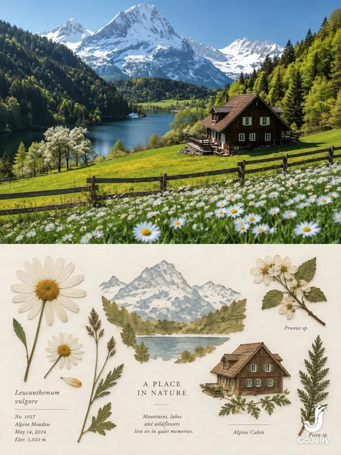
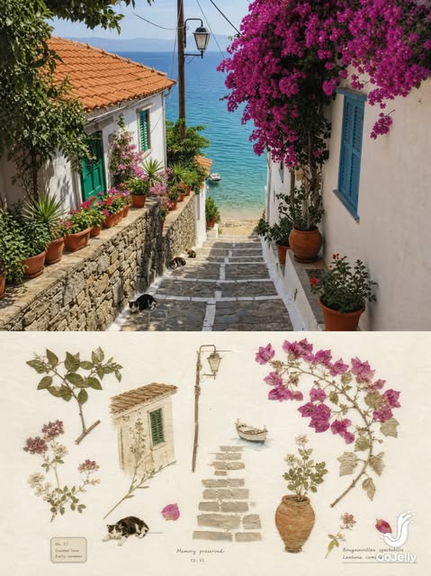
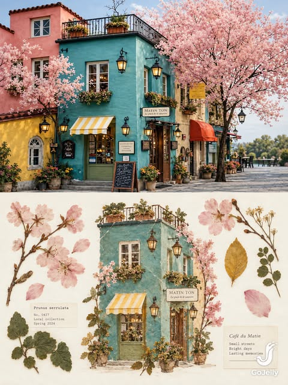
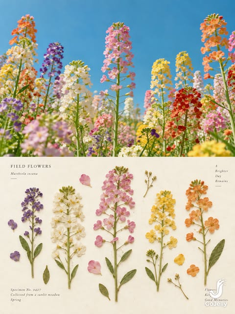
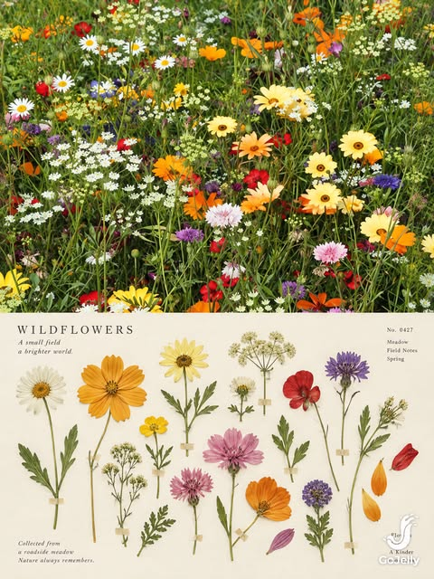

# 把照片變成押花標本回憶

## 摘要

@grace.hollin192026 分享將照片製成 3:4 直式海報的提示詞：上半部保留原照，下半部把人物、景物或植物轉化為帶有留白與細小註記的押花標本頁。[Threads 原貼文](https://www.threads.com/@grace.hollin192026/post/DeT0Z5lk0-7)

## 內文或摘錄

> What if you could press a memory like a flower? 🌿  
> Turned a photo into a tiny specimen archive — fragile little details,kept forever.  
> prompt below ⬇️⬇️⬇️

### 作者英文提示詞

[Threads 作者提示詞回覆](https://www.threads.com/@grace.hollin192026/post/DeT0amPE3U9)

```text
Use each uploaded photo as the only visual source.Create one independent high-end editorial poster per photo and output each one separately.Do not combine multiple photos into one image and do not make a collage.Use a vertical 3:4 composition divided into two clearly separated horizontal halves,with the upper 50% and lower 50% occupying equal height.The overall concept is real photography above + pressed-specimen memory archive below.

Upper Half·Original Photograph Keep the upper half fully photographic and faithful to the uploaded image.Preserve the subject’s identity,number,pose,outward features,clothing,accessories,interaction relationships,environment,perspective,natural light,and original color atmosphere.The subject may be a person,pet,animal,plant,object,architecture,or travel scene.Apply only subtle premium editorial color grading and an extremely light film-grain layer so the image feels like a page from an art magazine,independent publication,or exhibition photography series.If needed to fit the 3:4 format,you may only extend surrounding background areas naturally and seamlessly.Do not stretch,distort,replace,or redesign the subject.Do not place text,illustration,or decorative graphics in the upper half.

Lower Half·Botanical Press Memory Reconstruction Reconstruct the same image as a pressed-specimen memory sheet on bright natural paper.The lower half should feel like a poetic botanical archive page,as if the memory from the photo has been gently flattened,pressed,and preserved inside a field notebook or specimen album.Do not make it look like a busy scrapbook or a craft collage.Instead,use a sparse,carefully composed botanical-archive language.

Translate the main subject and selected environmental clues into flat preserved forms.A person may become a pressed-memory silhouette built from simplified clothing contours,flattened hair shapes,and preserved gesture fragments.A pet or animal may become a softly flattened preserved figure whose pose and direction remain recognizable.Architecture,roads,flowers,branches,grass,or objects may become pressed fragments,thin contour remnants,or specimen-like cut forms.The goal is not to redraw everything literally,but to preserve the most memorable identity cues,pose,structure,direction,and emotional tone of the original image in a flattened archival form.

Visual Language and Material Logic Build the lower half using the visual logic of a specimen page:pressed leaves,dried petals,flattened flower heads,thin stems,delicate silhouette fragments,lightly faded preserved shapes,faint specimen shadows,tiny pin-marks,small collector marks,and carefully spaced labels.The page should feel like a real preserved-memory sheet made of fragile natural forms resting on paper,not like painted illustration or glossy digital collage.Forms should appear thin,pressed,gently desaturated,and lightly textured,with subtle paper contact shadows and slight translucency where appropriate.

If the source photo contains people,pets,or strong narrative subjects,translate them into a pressed-memory composition rather than a literal human or animal drawing.For example,clothing outline may become leaf-like fabric contours,hair may become soft pressed fibers,a walking pose may be suggested by flattened limb silhouettes,and a pet’s body may be simplified into preserved curved forms while keeping its posture immediately recognizable.Environmental clues such as branches,flowers,grass,shorelines,window shapes,chairs,or travel details may appear as selected preserved fragments around the main subject.

Composition Keep the lower half sparse,airy,and archival.Use generous negative space on bright off-white,ivory,or pale natural paper.The preserved subject should occupy only a moderate central or slightly offset area,with surrounding fragments arranged in a calm,editorial way.Do not fill the page.Use asymmetry and breathing room.The result should feel scientific yet poetic,quiet yet highly designed.

Typography and Annotation You may add a very small amount of restrained archival text,such as tiny specimen numbers,collector notes,micro labels,or a short Latin-style or observational notation.Keep all text minimal,light,and secondary.Let it feel like refined archive annotation rather than a poster headline.Text should sit naturally in the blank paper areas and never dominate the composition.

Color System Extract the main colors from the original photograph and reinterpret them as softened preserved-natural tones.Use restrained botanical colors such as faded greens,dried rose pinks,soft yellows,warm browns,pale violets,muted blues,or quiet cream neutrals.Keep the palette light,natural,and memory-like.Avoid harsh saturation,fluorescent color,and graphic poster contrast.

Overall Style Goal The final poster should feel like a premium editorial art print:real photography above,and below,the same moment transformed into a pressed botanical memory archive.The lower half should feel preserved,delicate,observational,and emotionally resonant—as if the memory has been collected,pressed into paper,and kept for a long time.

Negative Constraints No multi-photo collage,no scrapbook overload,no crowded craft decoration,no glossy digital collage,no realistic full-scene redraw,no heavy painting,no thick 3D texture,no loud poster headline,no dense layout,no random stickers,no messy journal clutter,no decorative border overload,no logo,no watermark,no UI,and no gibberish text.
```

### 提示詞重點

- 每張照片獨立輸出，上下各占一半。
- 保留照片主體、姿態、光線與色彩；下方只提取最有記憶點的元素。
- 使用乾燥花葉、淡色紙張與少量標本註記，避免擁擠拼貼或厚重 3D 質感。

### 資源

作者另在[回覆](https://www.threads.com/@grace.hollin192026/post/DeT0bFlkxv9)附上 [GoJelly 靈感頁](https://gojelly.ai/zh-tw/inspiration/pressed-memories-gpt-image-20--cmv25qalu0tgkpa01r3pkvvat)。示範圖帶有 GoJelly 標誌，雖然提示詞要求不要浮水印。

## 圖片

以下依主貼文輪播順序保存 5 張示範圖，展示原照與押花標本頁的上下對照；均為 JPEG，第 2 張為 479 × 640，其餘為 480 × 640。











作者可見回覆包含文字提示詞與 GoJelly 連結卡片，未見獨立圖片或影片；卡片預覽及其他使用者回覆的圖片未收錄。頁面提示部分新增回覆無法顯示。
