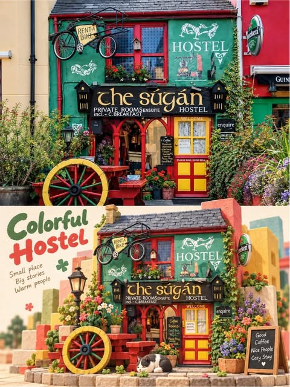
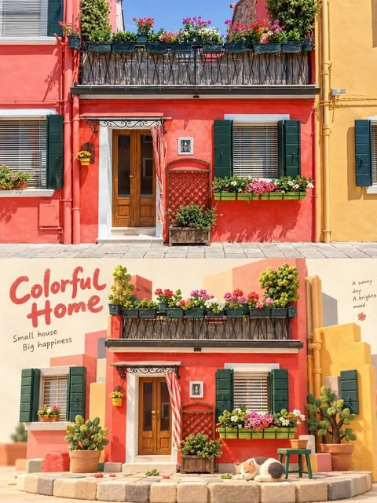

# 照片變成療癒系積木海報

## 摘要

@blissful_nala 分享將照片獨立製成 3:4 直式海報的提示詞：上半部保留原照，下半部將照片的主要特徵重構為具有空間感的療癒系積木雕塑。[Threads 原貼文](https://www.threads.com/@blissful_nala/post/DeUgdZZGlMF)

## 內文或摘錄

主貼文：「一天一个提示词 超特别的插画风～」

### 作者原始提示詞

[Threads 作者回覆](https://www.threads.com/@blissful_nala/post/DeUgdQ7mrkV)

```text
提示词：提示词：
请将我上传的每一张照片分别制作成一张独立的3:4竖版高级设计海报；每张照片单独输出一张完整图片，不拼接、不合并。整张画布上下严格1:1划分，上半区占50%，下半区占50%，分界清晰，比例不得偏移。上半区使用对应原始照片作为真实摄影画面，根据画幅自然裁切或适度延展环境背景，使主体、构图和空间完整成立；必须保留主体结构、身份、姿态、动作、比例、服装、配饰、物体关系、透视、真实材质、自然光影、景深和原有色彩氛围，不拉伸、不扭曲、不改变主体，不新增无关元素；仅做轻微高级摄影调色，使其具有艺术杂志、独立出版物和展览摄影质感。

下半区以同一张上方照片为唯一依据，将照片内容按“解构、筛选、提炼、重构”的逻辑转化为3D/isometric空间感的治愈系积木雕塑。先提取照片中最具识别性的主体、轮廓、姿态、叙事关系、视觉重心、轴线曲线体量比例穿插层叠遮挡关系与负空间，再用圆润、简洁、有触感的模块化体块重新组织；不完整复刻细节，但必须一眼能感到与上半区原图对应。构图需根据不同照片自适应设计主体位置、朝向、大小、裁切、疏密和留白，通过大小体块、高低错层、前后穿插、局部悬浮、拼接、叠放、嵌套、穿越或自然错位建立节奏，让主体既保留身份，又有当代艺术玩具般的雕塑感和想象力，避免机械拆件、简单像素化、乐高式复制和模板感。

下半区配色必须从上方原图分析产生：识别最有生命力和辨识度的主色关系、综合色温明度层级冷暖呼应与关键点色，再调制为柔和清澈明亮有空气感的治愈色彩；保留原图色相身份与情绪记忆，适度提高明度、降低刺眼对比、净化灰脏杂色，不固定色卡，不强行加入原图不存在的颜色。色彩以主色面积、辅助色层次、同源深浅和少量鲜活点色建立节奏，丰富但不杂乱，可爱但不甜腻。

积木材质为细腻哑光、柔和漫反射，带轻微纸浆、木质、粉蜡或柔性材料触感，边角圆润阴影轻柔，避免塑料高光、金属感、厚重CG和廉价玩具质感。文字采用轻盈高级编辑式微排版，从照片光影、动作、空间、情绪或象征意义中提炼一个2到5词标题，并搭配少量状态词、地点、编号、方向词或微型注释，不使用年份；文字可沿积木边缘、模块缝隙、视觉轴线或负空间排列，也可与体块穿插、遮挡、对齐，成为构图的一部分。整体温柔、轻盈、童趣、安静、精致，有想象力但不幼稚。
```

### 提示詞重點

- 原照與積木雕塑上下各占一半，每張照片獨立輸出。
- 提煉照片的辨識特徵，以圓潤模組化體塊重組，避免機械拆件或樂高式複製。
- 從原照取色，使用柔和霧面、帶紙漿或木質觸感的材質。
- 依場景產生 2–5 個詞的標題與少量編排註記，不使用年份。

### 自己試作時

選一張主題明確的照片，貼入作者提示詞；檢查原照是否保留、雕塑是否仍能辨認原場景，以及生成文字是否正確。

## 圖片

以下依主貼文輪播順序保存 3 張示範圖，展示原照與積木雕塑海報的上下對照；均為 JPEG、480 × 640。






作者可見回覆包含提示詞與兩則簡短文字，未見獨立圖片或影片；其他使用者回覆的圖片未收錄。
