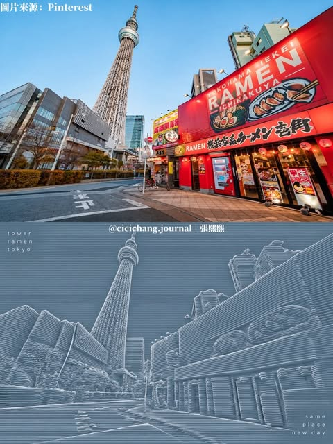
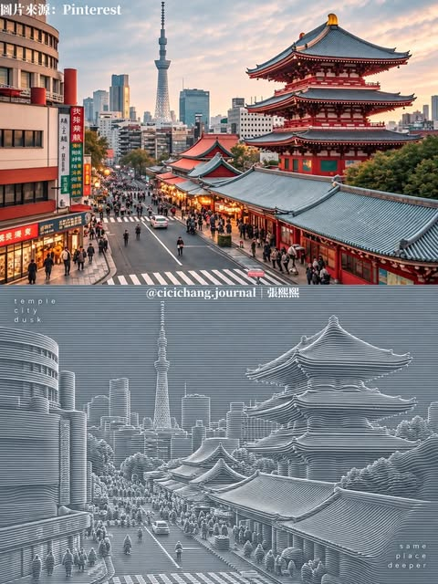
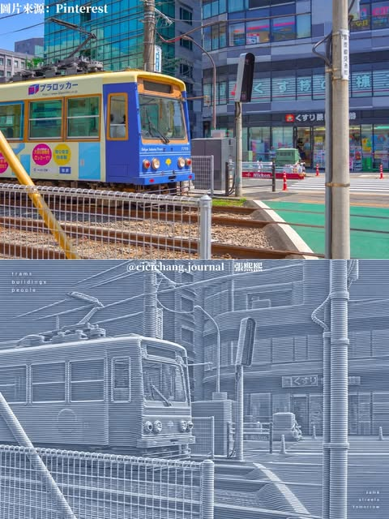

# 照片變成線條浮雕海報

## 摘要

@cicichang.journal 分享將照片製成 3:4 直式雙聯畫的提示詞：上半部保留原照，下半部使用等距水平白線重新呈現相同場景，讓線條隨主體彎曲形成立體浮雕效果。[Threads 原貼文](https://www.threads.com/@cicichang.journal/post/DeVeCyun-nb)

## 內文或摘錄

主貼文文字：「沒想到簡約線條 也可以這麼好看😍😍(附prompt)」

### 作者英文提示詞

[Threads 作者回覆](https://www.threads.com/@cicichang.journal/post/DeVeCrTnyqX)

```text
3:4 vertical diptych from the uploaded photo, two equal halves.

TOP: the original photo, unchanged.

BOTTOM: same scene and composition as line-displacement art. Thin, evenly spaced, parallel horizontal white lines on a flat muted background color sampled from the photo. Lines stay straight over empty areas (sky, water, ground) and bend and rise to sculpt the main subjects as smooth 3D embossed relief, with soft light and shadow. No outlines, no fills, no extra colors.

TEXT: tiny lowercase thin white sans-serif, wide letter spacing. Three stacked words upper-left of the bottom half, three stacked words lower-right, a short poetic phrase about the scene.

Minimalist, calm, editorial graphic design, crisp lines.
```

### 自己試作時

選一張主體輪廓清楚的照片，貼上提示詞；檢查上下構圖、線條是否連續，以及英文題字是否正確。

## 圖片

以下依主貼文輪播順序保存 3 張示範圖，展示原照與線條浮雕的上下對照；均為 JPEG、480 × 640。圖中標示照片來源為 Pinterest，使用照片前應確認授權。







作者可見回覆為文字提示詞，未見獨立圖片或影片；其他使用者回覆的圖片未收錄。
