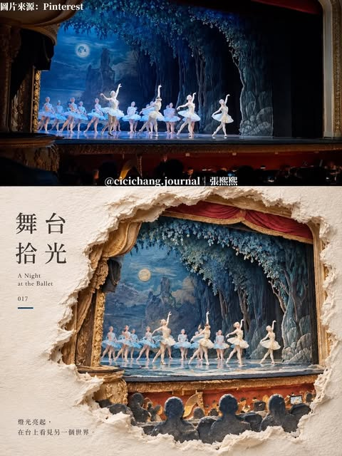
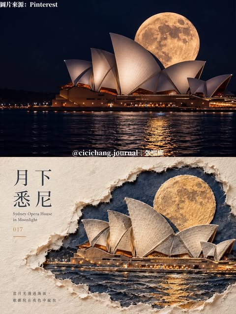
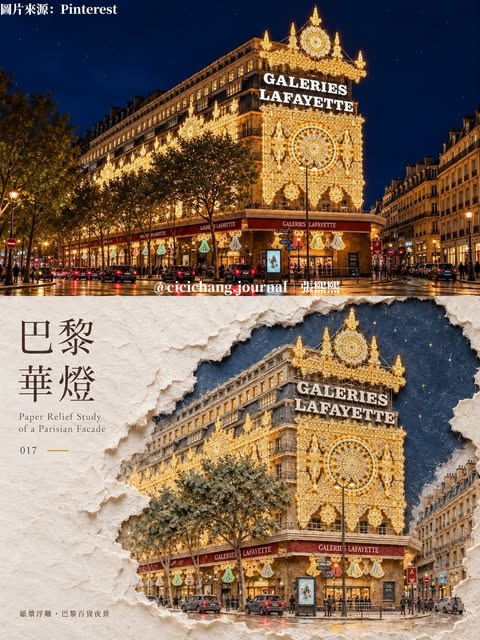

# 照片變成紙漿浮雕海報

## 摘要

@cicichang.journal 分享將照片製成 3:4 上下對照海報的提示詞：上半部保留照片，下半部把同一場景轉成手工紙漿浮雕，搭配撕裂紙邊、柔和陰影與水彩背景。[Threads 原貼文](https://www.threads.com/@cicichang.journal/post/Defm2uDn3GQ)

## 內文或摘錄

主貼文：「為什麼這個會這麼好看啦 浮雕系列太有質感了😍（附prompt)」

### 作者英文提示詞

[Threads 作者回覆](https://www.threads.com/@cicichang.journal/post/Defm2jcH7Ot)

```text
3:4 vertical, top-and-bottom comparison split by a clean straight horizontal cut. Top half: the reference image as a realistic photo. Bottom half: the same subject, same position, as a handmade paper-pulp relief poster.

Bottom style: off-white textured handmade paper with torn, fibrous edges revealing the scene inside. Key elements sculpted as 3D miniature relief with soft shadows, background fading into watercolor pigment. Muted palette from the original plus one accent color. Subject on the right, empty paper space on the left. Soft light from upper left, macro craft photography.

Typography top-left: 4-character Chinese title in thin Song serif (2×2), small English serif subtitle, serial number like 017, short accent-color line. Tiny Chinese caption at bottom-left.

No labels like "原圖", "紙漿浮雕", "Before", "After".

--ar 3:4
```

### 自己試作時

上傳照片並貼入提示詞，檢查上下場景、紙漿質感與中英文文字；比例參數 `--ar 3:4` 的支援方式依使用的產圖工具而異。

## 圖片

以下依主貼文輪播順序保存 3 張示範圖，展示原照與紙漿浮雕海報的上下對照；均為 JPEG、480 × 640。圖中標示照片來源為 Pinterest，使用照片前應確認授權。







作者可見回覆包含提示詞及簡短文字，未見獨立圖片或影片；頁面提示部分其他回覆無法顯示。
