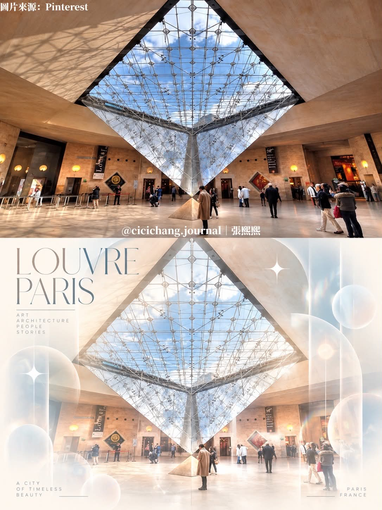
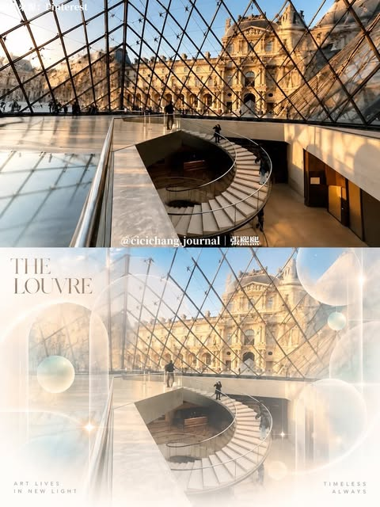
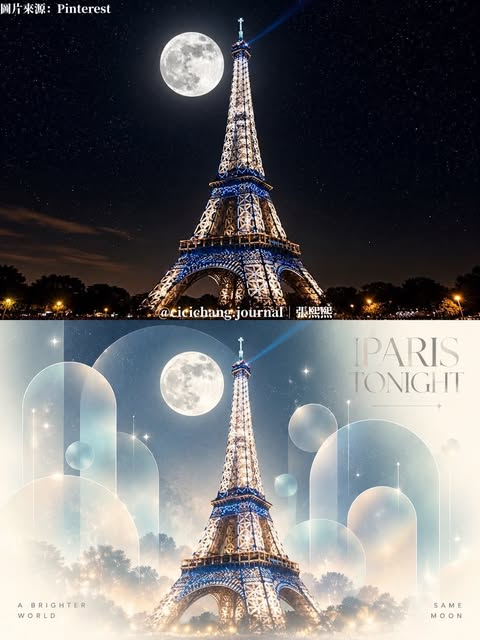

# 照片變成夢幻玻璃感海報

## 摘要

@cicichang.journal 分享將照片製成 3:4 上下對照圖的提示詞：上半部保留原照，下半部以原照配色加入霧面玻璃幾何、光點與柔霧，呈現夢幻編輯風海報。[Threads 原貼文](https://www.threads.com/@cicichang.journal/post/DeiLG3xn73y)

## 內文或摘錄

主貼文：「人人都能變成大藝術家😍😍 (附prompt)」

### 作者英文提示詞

[Threads 作者回覆](https://www.threads.com/@cicichang.journal/post/DeiLGv4n6Ja)

```text
Vertical 3:4 before-and-after image of the uploaded photo, two equal stacked panels joined edge to edge with no divider line, gap or border.

TOP: the original photo exactly as-is, vivid and untouched, no overlays or text.

BOTTOM: same scene and composition as a dreamy editorial poster — high-key pastel palette from the photo's own colors, misty haze fading to ivory-white at the side and bottom edges, layered frosted-glass rounded rectangles, arches and circles, small translucent orbs, four-pointed star sparkles, hairline lines. Thin elegant uppercase serif title in a top corner, small letter-spaced sans-serif taglines in the lower corners.

Calm, premium, ultra-detailed. Aspect ratio 3:4.
```

### 自己試作時

上傳主題清楚的照片並貼入提示詞；檢查上下場景是否一致、原照是否保留，以及標題和文字是否正確。

## 圖片

以下依主貼文輪播順序保存 3 張示範圖，展示原照與夢幻玻璃感海報的上下對照；均為 JPEG，第 1 張為 1086 × 1448，其餘為 480 × 640。圖中標示照片來源為 Pinterest，使用照片前應確認授權。







作者可見回覆為文字提示詞，未見獨立圖片或影片。
