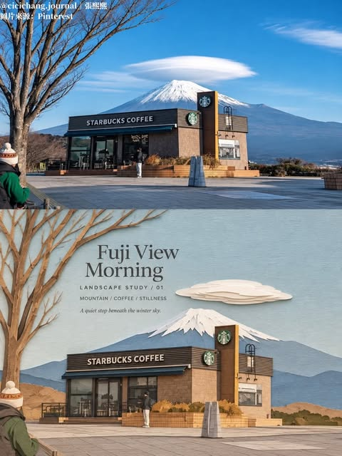
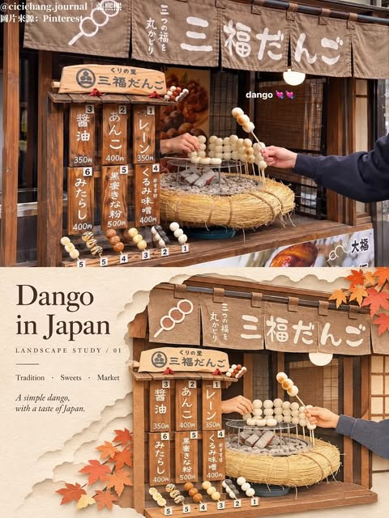
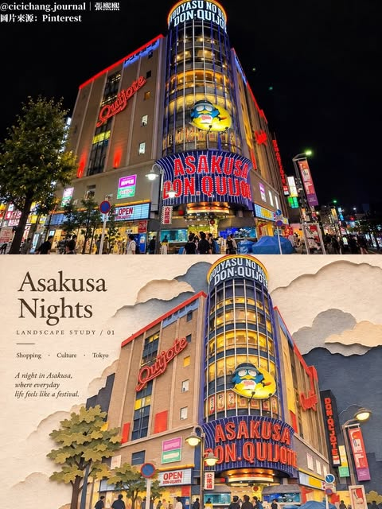
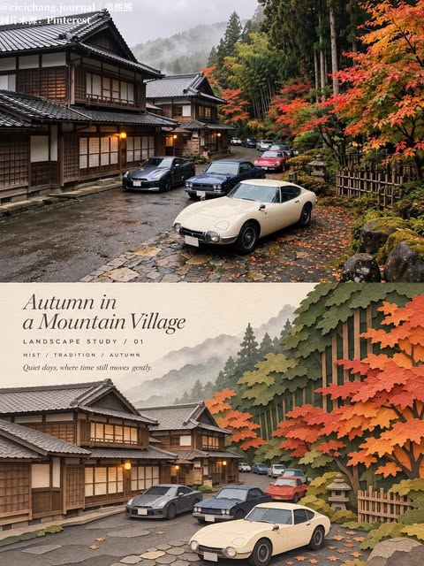

# 照片變成日系剪紙微縮海報

## 摘要

@cicichang.journal 分享將照片製成 3:4 上下對照圖的提示詞：上半保留原照，下半以卡紙層次、剪裁邊緣和柔和陰影重現場景，搭配雜誌式英文標題。[Threads 原貼文](https://www.threads.com/@cicichang.journal/post/DfqatAZEUy4)

## 內文或摘錄

主貼文：「連我自己都想收藏 超日 好看到爆炸😍😍(附prompt)」

### 作者英文提示詞

[Threads 作者回覆](https://www.threads.com/@cicichang.journal/post/Dfqas4ukWES)

```text
3:4 vertical image, top and bottom halves joined seamlessly, no white line or border.
TOP: the uploaded photo, unchanged.
BOTTOM: the same scene and composition recreated as a layered paper-cut diorama — textured cardstock, cut edges, soft shadows between layers, muted palette from the photo, cream paper background.
Upper-left of bottom half: editorial text — large 2-line serif title matching the mood, small spaced uppercase subtitle "LANDSCAPE STUDY / 01", 3 keywords, one short poetic line. Minimal, premium magazine style.
```

### 自己試作時

上傳照片並貼入提示詞，檢查原照、剪紙層次與生成文字是否符合預期。

## 圖片

以下依主貼文輪播順序保存 4 張示範圖，展示原照與剪紙微縮海報的上下對照；均為 JPEG、480 × 640。圖中標示照片來源為 Pinterest，使用照片前應確認授權。









作者可見回覆為文字提示詞，未見獨立圖片或影片；其他使用者回覆的圖片未收錄。
