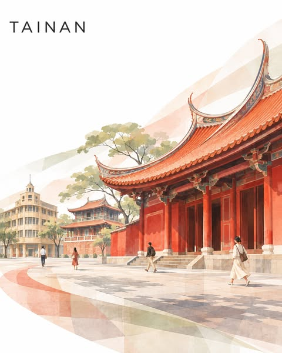

# 城市地標建築海報

## 摘要

@ai_traveler_k 分享城市建築海報提示詞：輸入城市與主要地標，生成 4:5 直式海報，並以共享廣場、淡色幾何與留白串聯其他地標。[Threads 原貼文](https://www.threads.com/@ai_traveler_k/post/Df6fkZgI_Jl)

## 內文或摘錄

> 熟悉的台灣，換個畫法竟然這麼不一樣。
>
> 你住的城市畫出來會是什麼樣子？
>
> 提示詞放留言，換上你的城市試試。

### 作者英文提示詞

[Threads 作者回覆](https://www.threads.com/@ai_traveler_k/post/Df6foBiIy25)

```text
Create a lyrical contemporary architectural city poster of [Landmark] in [City]. Vertical 4:5 on pure-white paper.

Automatically choose two recognizable supporting landmarks from [City] with contrasting structural forms. Creatively unite them around one continuous plaza, preserving authentic roof geometry, proportions and architectural character.

Use a dramatic low oblique viewpoint. Let the focal building’s defining curve sweep across much of the image. Keep supporting silhouettes distinct and connect all bases through one shared ground plane and horizontal flow. Include four small contemporary pedestrians.

Translate light into layered pale colors, translucent geometric planes and flowing contour rhythms. Add a few opaque dark anchors for clarity. Balance expressive simplification with believable structure and generous white space.

Place “[City]” in small uppercase SUIT-style sans-serif at the upper left, Regular or Medium, with restrained tracking and ample clearance.

Keep inscriptions blank. No other lettering, logos, borders, signatures or watermarks.
```

### 自己試作時

將 `[Landmark]` 和 `[City]` 換成想要的地標與城市。成品是創意合成，不代表實際地理位置；使用前應核對地標外觀與城市歸屬。

## 圖片

以下依主貼文輪播順序保存 6 張城市海報，展示淡色幾何與地標建築的組合；均為 JPEG，第 5 張為 1122 × 1402，其餘為 480 × 600。





作者可見回覆為文字提示詞，未見獨立圖片或影片；其他使用者回覆的圖片未收錄。
