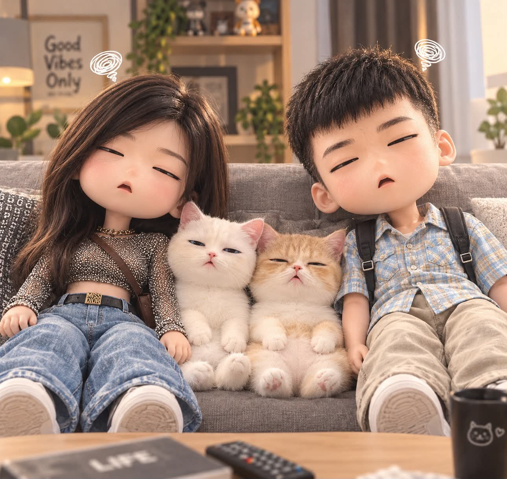
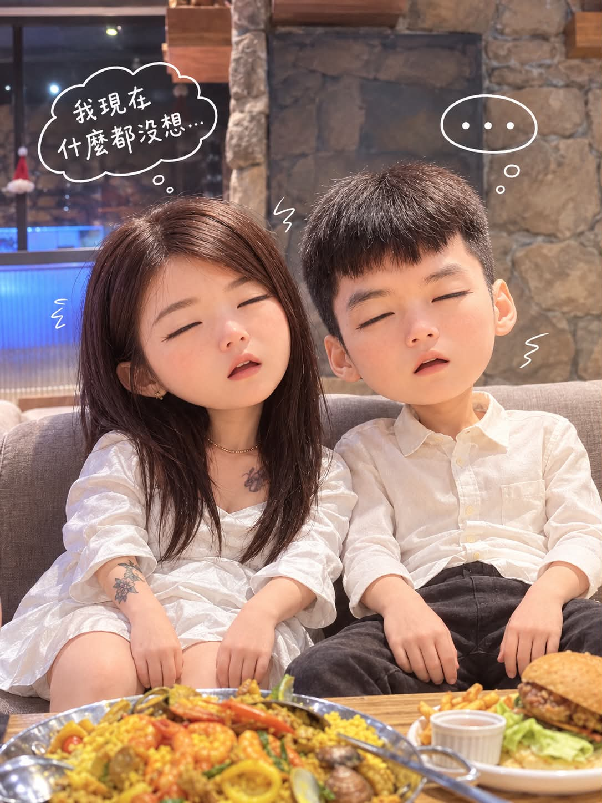
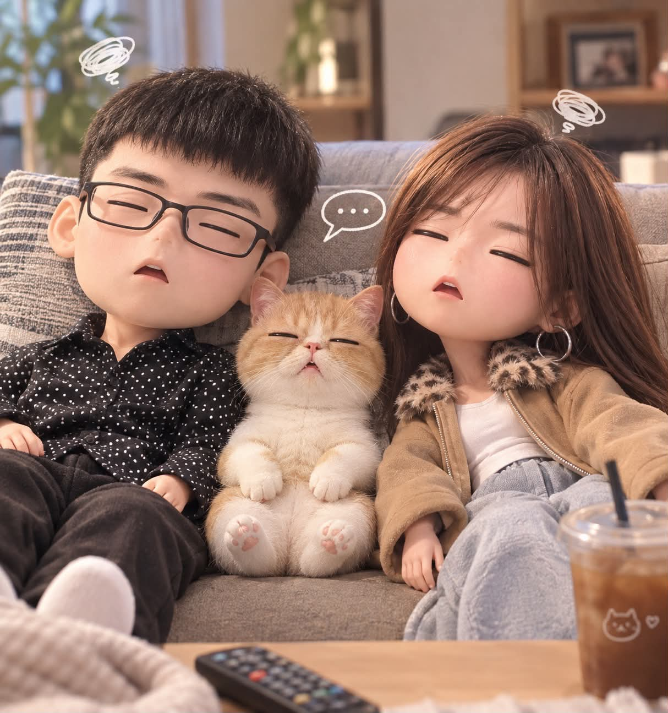
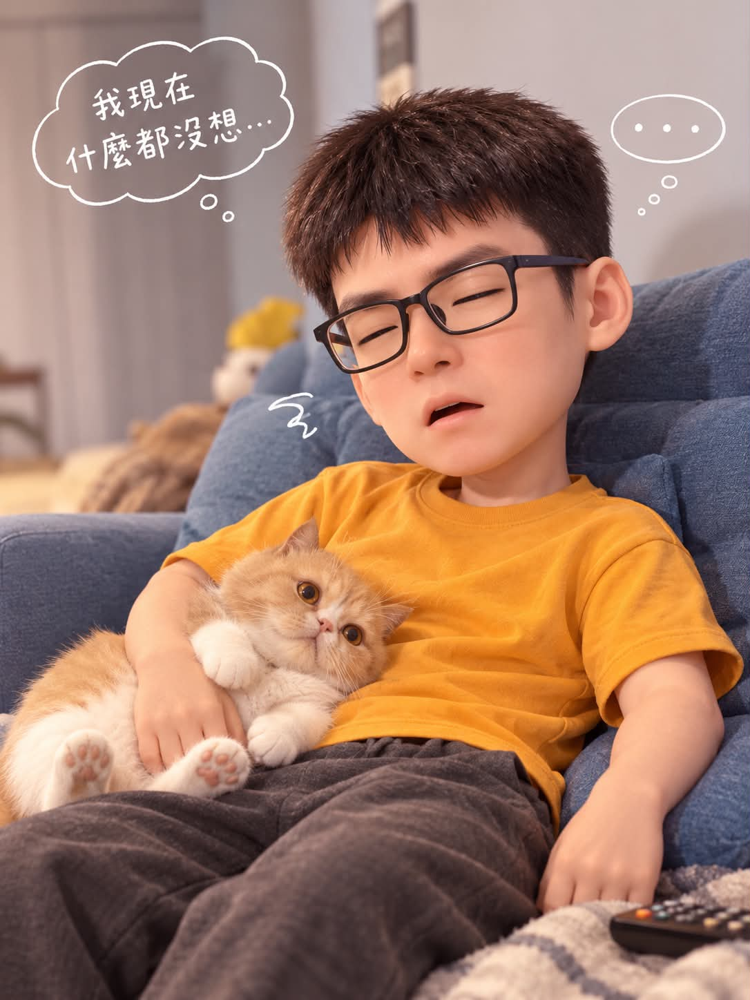
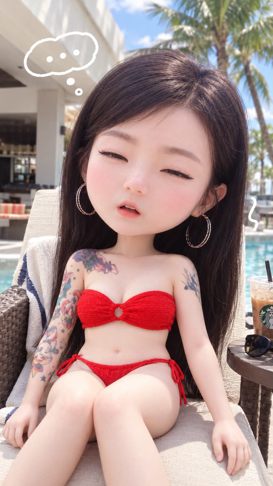
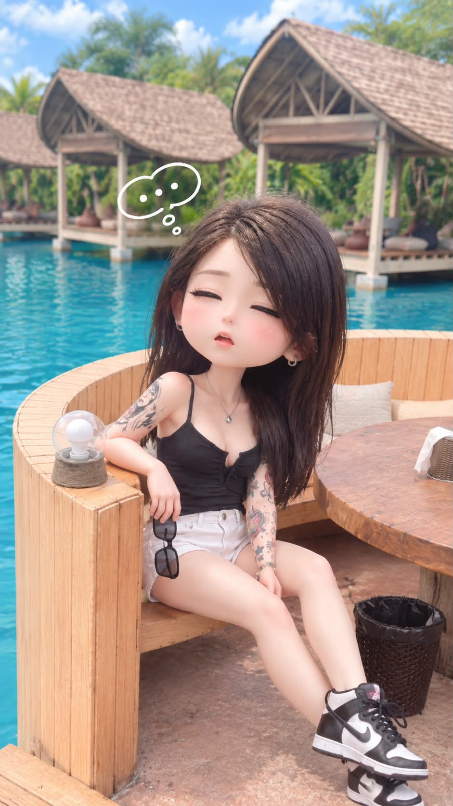
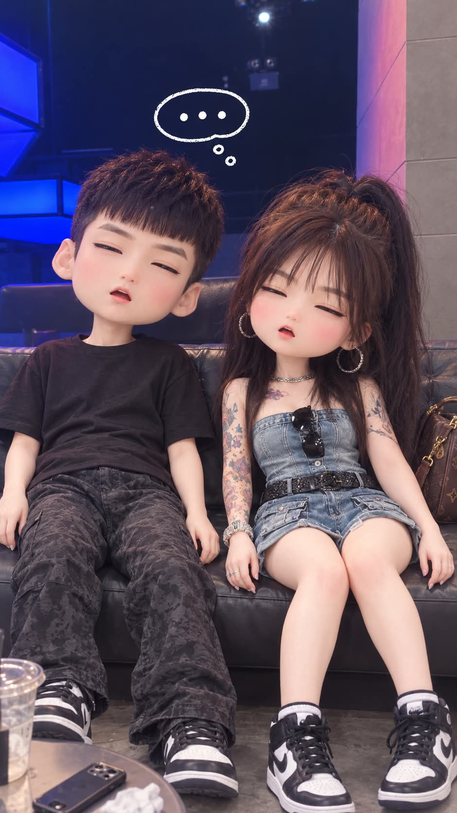

# 用照片製作「放空狀態」Q版人物

@r916sat 分享以真人照片生成約 2.5～3 頭身 Q版人物的提示詞，重點是保留人物辨識度，呈現閉眼、嘴微張、肩膀放鬆的「腦袋空白」表情。[Threads 原貼文](https://www.threads.com/@r916sat/post/DeTtQtvkkWL)

作者表示指令由其他脆友提供；目前未看到原始提供者的連結。

## 置頂提示詞

[Threads 作者置頂回覆](https://www.threads.com/@r916sat/post/DeTtUQCEjVn)

```text
■ 主角
必須完全依照我上傳的真人照片中的本人製作。
保留本人原本的：真實臉型、五官比例、眉眼特徵、鼻子與嘴型、膚色、髮型、髮色、年齡感、整體人物辨識度。不要換臉、不要重新設計臉部、不要生成陌生人物。即使轉換成Q版，也必須一眼看得出是照片中的本人。
製作成約 2.5～3頭身的可愛人類迷你角色，頭部稍微放大，身體小巧可愛。
■ 最重要：完全放空的表情
表現「我現在什麼都沒有在想」的狀態。眼睛幾乎完全閉上，只呈現細細的眼線。眉毛自然放鬆，不要皺眉。臉頰、眼皮、嘴角全部放鬆。嘴巴無力地微微張開，嘴唇自然放鬆。
不是笑臉。不是睡著。不是悲傷。不是生氣。也不是單純的疲憊。而是：
虛無、放空、腦袋當機、思緒停止、靈魂暫時登出。讓人第一眼看到臉，就能感受到：
「……」
「我現在，什麼都沒想。」
「腦袋完全空白。」
表情要自然、可愛又有一點幽默感，不要過度誇張。
■ 姿勢與構圖
身體同樣完全放鬆。肩膀自然下垂，整個人呈現沒有力氣的狀態。可以讓本人：
* 癱坐在沙發上
* 無力地坐在椅子上
* 呆呆站著
* 靠著牆發呆
* 手自然垂下
* 軟趴趴地坐著
```

## 主貼文示範圖

以下依主貼文輪播順序保存，均為 JPEG。









解析度依序為 1290 × 1219、1086 × 1448、1214 × 1295、1086 × 1448。

## 作者後續回覆示範圖

[Threads 作者後續回覆](https://www.threads.com/@r916sat/post/DeWOw-tkmGp)中另有三張圖片，以下依輪播順序保存，均為 JPEG。







解析度依序為 941 × 1672、941 × 1672、940 × 1672。置頂提示詞回覆未見獨立圖片或影片。

## 提示詞重點

- **人物**：參考上傳照片，保留臉型、五官、膚色、髮型與年齡感。
- **表情**：不是睡著或悲傷，而是自然、略帶幽默的完全放空。
- **姿勢**：可癱坐沙發、靠牆發呆或自然垂手。

## 自己試作時

1. 選用經人物同意的參考照片，確認產圖服務如何處理照片。
2. 上傳照片並貼入置頂提示詞，可依需求指定姿勢或場景。
3. 檢查成品是否仍能辨認本人，以及表情是否符合想要的放空狀態。
