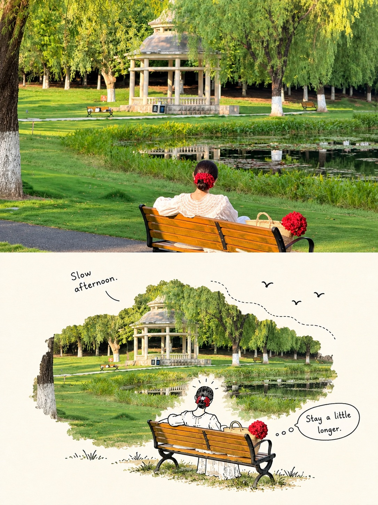
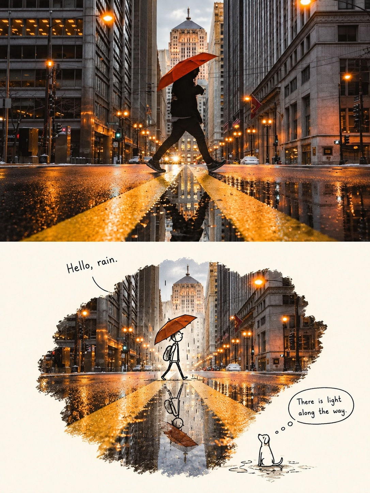
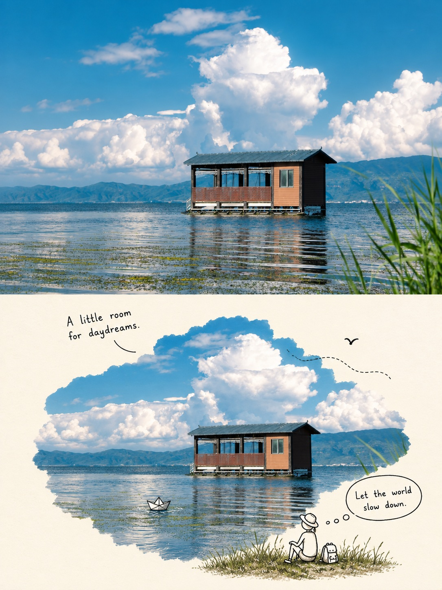
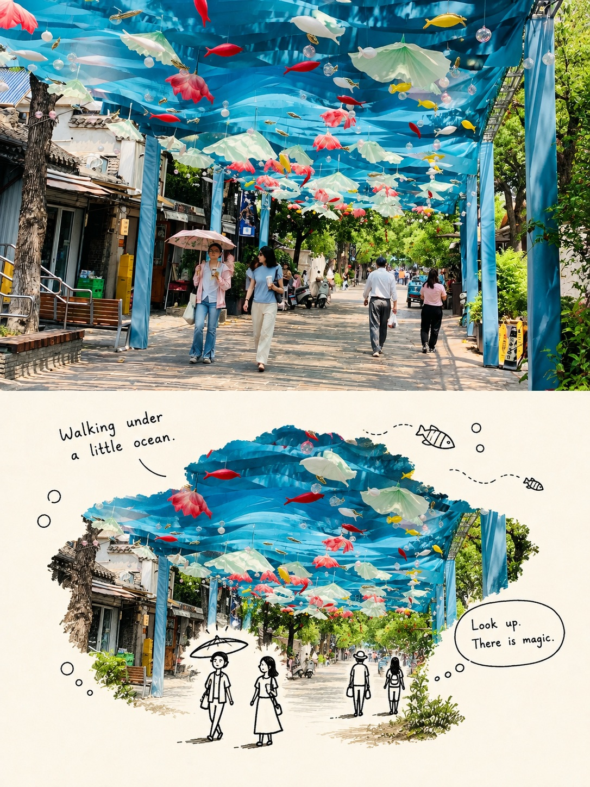

# 實景拼貼 × 手繪塗鴉

@ellain_tech 分享將照片做成 3:4 直式作品的提示詞：上半部保留原照，下半部以奶油色紙張承載不規則照片剪貼，搭配與場景互動的黑線小人。[Threads 原貼文](https://www.threads.com/@ellain_tech/post/DeTzWzRm8uF)

## 作者原始提示詞

[Threads 作者回覆](https://www.threads.com/@ellain_tech/post/DeTzXbWG0dC)

```text
將我上傳的照片製作成一張 3:4 直式「實景拼貼 × 手繪塗鴉」作品。
上半部呈現原照片的攝影質感，保留主要人物、景物、色彩與光線；下半部使用奶油色紙張背景，將同一場景製作成不規則邊緣的照片剪貼，保留真實的景物紋理。
在下半部加入簡潔的黑色鋼筆線條人物，讓小人與場景互動，例如坐在長椅上、撐傘散步或在湖邊看風景。搭配少量虛線、小鳥、波紋，以及簡短的英文手寫旁白或對話框。
整體輕鬆、有童趣，保留充足留白。避免將整張照片轉成卡通或油畫，不要密集裝飾、巨大文字、邊框或水印。每張照片獨立製作。
```

## 作者示範圖

以下依主貼文輪播順序保存；四張均為 JPEG、1086 × 1448。









## 提示詞重點

- 上半部保留人物、景物、色彩與光線；下半部以不規則邊緣的照片剪貼保留真實紋理。
- 讓黑色鋼筆線條小人與場景互動，搭配少量虛線、小鳥、波紋或英文旁白。
- 保留留白；避免整張照片變成卡通或油畫，也避免密集裝飾、巨大文字、邊框及水印。

## 自己試作時

1. 選一張場景清楚的照片，並貼入作者提示詞。
2. 檢查原照質感、小人與場景的互動，以及英文文字是否符合預期。

## 回覆與媒體狀態

作者可見回覆包含提示詞與簡短文字，未見獨立圖片或影片。其他使用者的回覆圖片未收錄；頁面提示部分新增回覆無法顯示。
