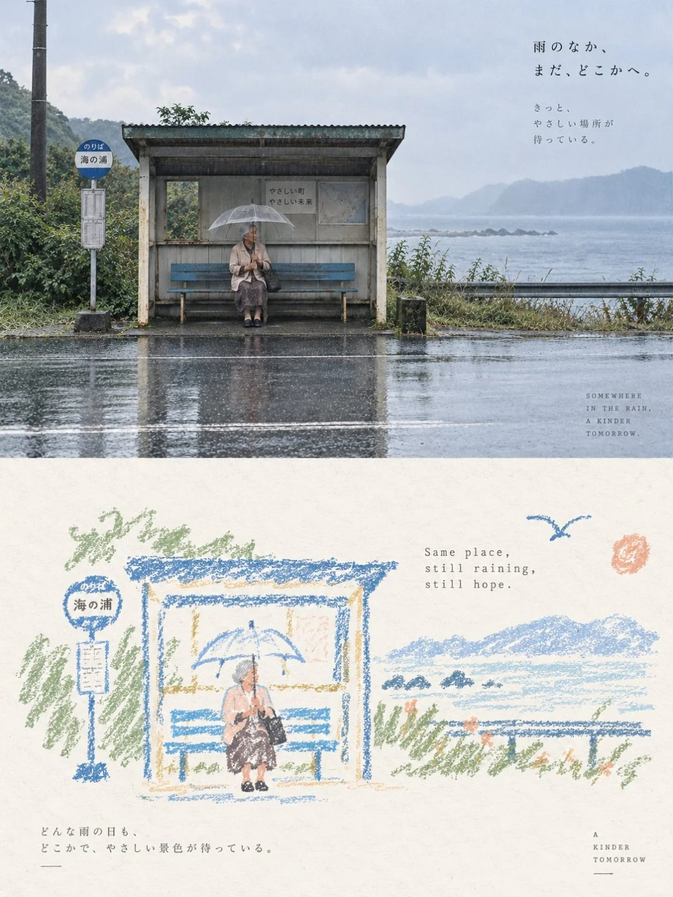
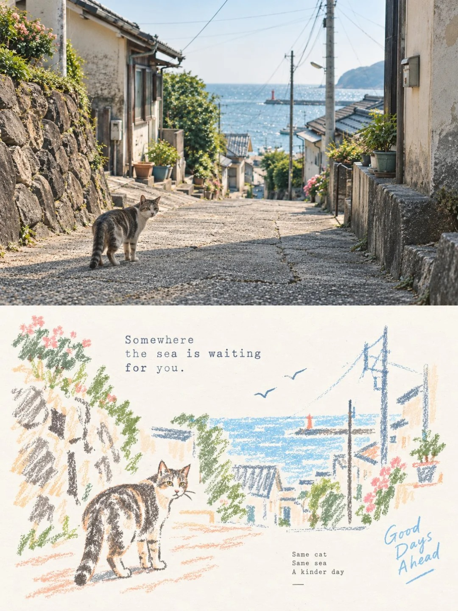
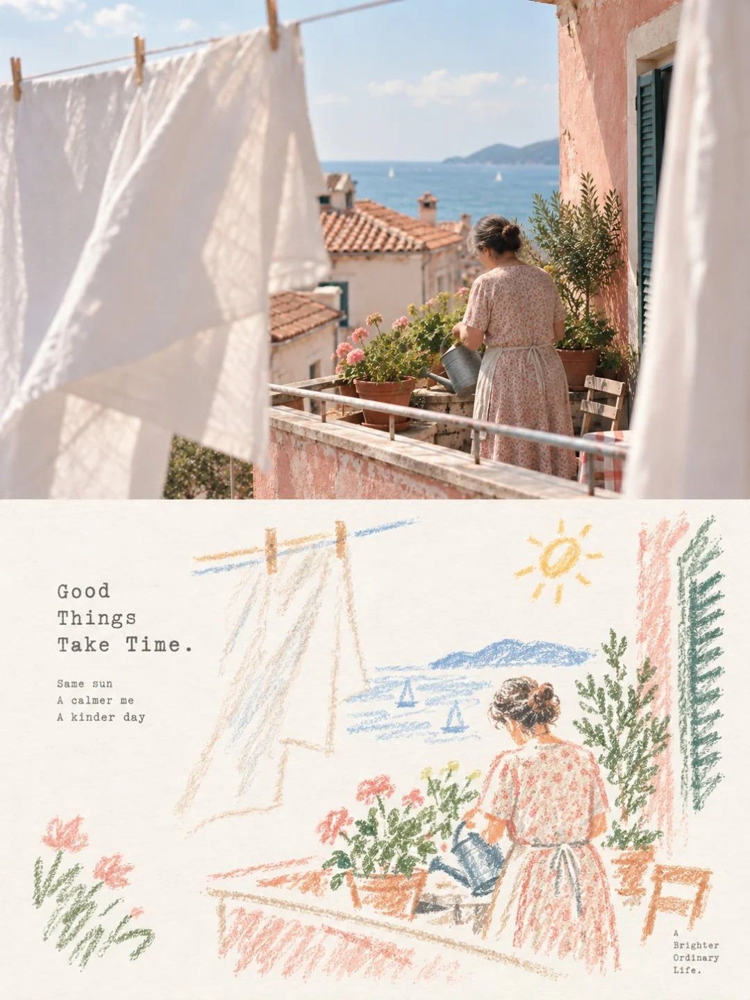
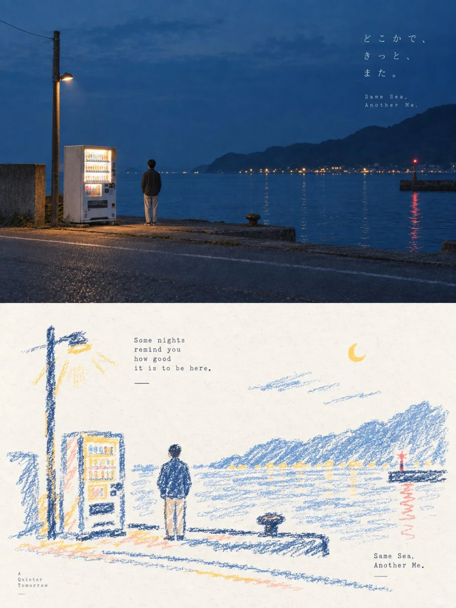

# 旅遊照片變成粉彩蠟筆海報

@miafunaivideo 分享一組提示詞，將每張照片各自轉成 3:4 直式海報：上半部保留照片，下半部以粉彩蠟筆概括主題、輪廓與氛圍，搭配淺色紙張和大面積留白。[Threads 原貼文](https://www.threads.com/@miafunaivideo/post/Dd_OJdDDF-O)

## 作者原始提示詞

作者將提示詞分在三則回覆；以下保留原文及出處。

### 海報結構與蠟筆主體

[作者回覆 1](https://www.threads.com/@miafunaivideo/post/Dd_OKtXjDOM)

```text
请将我上传的每一张照片分别制作成一张独立的高级设计海报，不多图拼接，每张照片单独输出。整体采用3:4竖版构图，上下两个区域高度严格1:1，各占画面50%。

上半部分保留原始照片，保持主体身份、结构、姿态、真实质感、自然光影和原有色彩氛围，仅进行轻微高级调色，使其具有艺术杂志、独立出版物与展览图像质感。为适配画幅，可自然扩展环境背景，但不得拉伸、扭曲或改变主体。

下半部分先理解原照片最值得被记住的**核心主题、主体关系、结构走势、情绪与视觉隐喻，再重构为复古纸张肌理的粉彩蜡笔涂鸦插画。不要逐物复制照片，也不要把所有内容完整转绘，只保留最能代表原物的轮廓、姿态、方向和视觉记忆点，通过删减、概括、轻微夸张和重新组合，使人一眼感受到它与上方照片之间的对应关系。

主体使用**粗颗粒粉笔 / 蜡笔式手绘轮廓**：线条略粗、松弛、干涩，带有粉末颗粒、断续掉色、轻微抖动和不完全闭合的边缘，笔端自然钝圆。主体内部只加入极少量粉彩色块、简单网格、条纹、圆点或随手涂抹，用最少信息提示结构，不做写实体积和完整细节。
```

### 小元素、留白與背景

[作者回覆 2](https://www.threads.com/@miafunaivideo/post/Dd_OLqKjOeq)

```text
周围小元素与主体使用**同一种线条语言**，但进一步压缩为一笔或几笔即可识别的涂鸦符号。星星、花朵、植物、器物、环境线索或抽象符号都应简单、稚拙、开放、不完全闭合，以单线轮廓为主，极少填色。不要画成精致图标、贴纸或独立小插画。

构图保持**小尺度章印与大面积留白**的关系，根据主体自身的方向、比例和视觉重心自由安排位置，可偏心、贴边、悬置或局部裁切。主体与极少量涂鸦符号形成松散但明确的视觉群落，其余空间主动留空。**留白本身就是主要构图元素**，通过空与实、聚与散、大小反差和不对称关系形成呼吸感、距离感与停顿感；宁可少画，也不要填满。

背景必须使用**极浅、明亮、干净的纸张底色**，例如奶油白、象牙白、浅米白、淡杏白、极浅灰白或根据原图综合色温智能匹配的近白纸色。纸张只保留非常轻微的纤维与颗粒，不能偏棕、偏黄、偏灰或显得陈旧。**背景明度必须明显高于主体线条与色块，确保所有蜡笔轮廓、小符号和文字清楚可见，不得与背景糊在一起。**
```

### 配色

[作者回覆 3](https://www.threads.com/@miafunaivideo/post/Dd_OMtEjIL3)

```text
配色从上方照片中提取 **2–4 种最鲜活、最有亲和力、最能代表画面精神的颜色**重新调制，转化为明亮柔和的粉彩蜡笔色。可自然形成蜜桃粉、杏橙、奶油黄、薄荷青、天空蓝、淡紫等轻盈色彩；主体线条优先使用比背景更清晰的珊瑚粉、柔蓝、青绿、暖橙、淡紫或奶油深色调……
```

第三則回覆目前顯示的文字以「……」結尾，無法確認是否還有後續。頁面也提示部分新增回覆無法顯示；三則可見作者回覆未見獨立媒體。

## 作者示範圖

以下依主貼文輪播順序保存，四張均為 JPEG、1080 × 1440。









## 提示詞重點

- 每張照片獨立輸出，上下各占 50%；保留上方照片的主體與自然光影。
- 下方以粉彩蠟筆概括照片的視覺記憶點，不必逐物描摹。
- 圖案使用粗顆粒線條與簡化的小符號，搭配大面積留白。
- 背景使用明亮的近白紙色，並從照片提取 2–4 種代表色。

## 自己試作時

1. 選擇主體清楚、適合上下對照的照片，逐張上傳。
2. 依序貼入作者三段可見提示詞；第三段後續目前無法確認。
3. 檢查原照主體是否被扭曲、插畫是否保留辨識點，以及留白和文字是否清楚。
