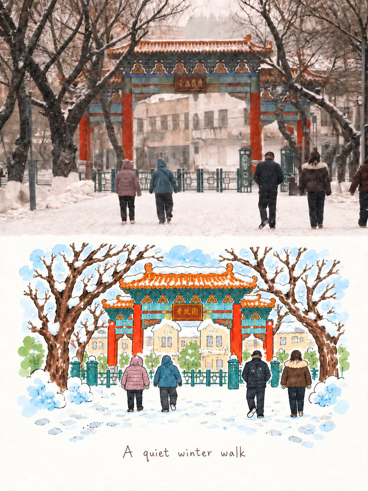
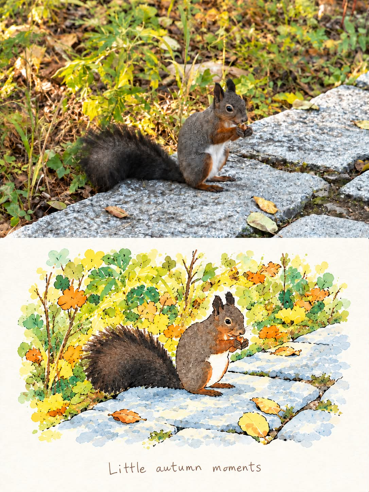
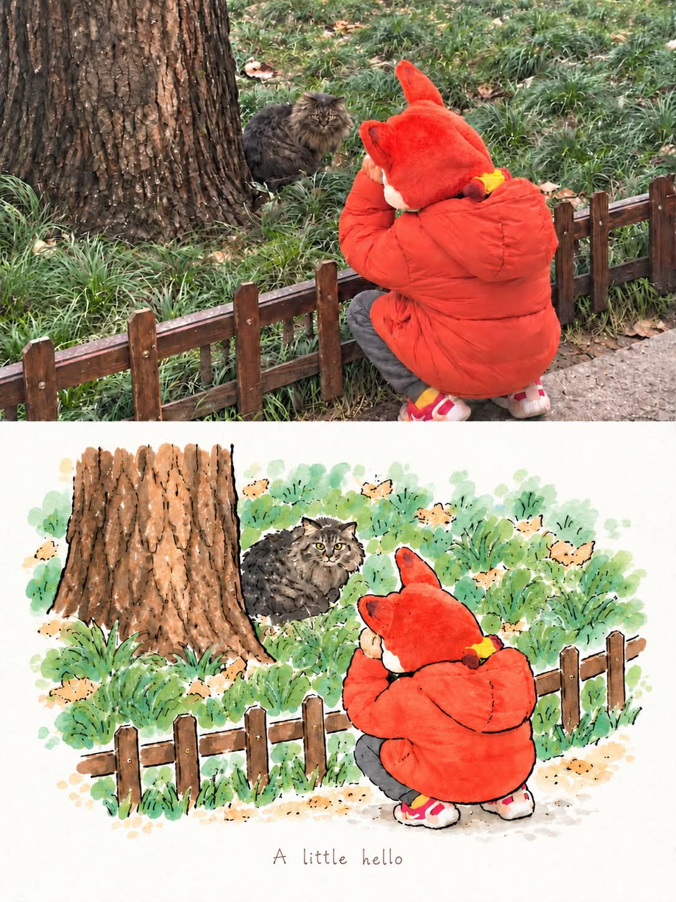
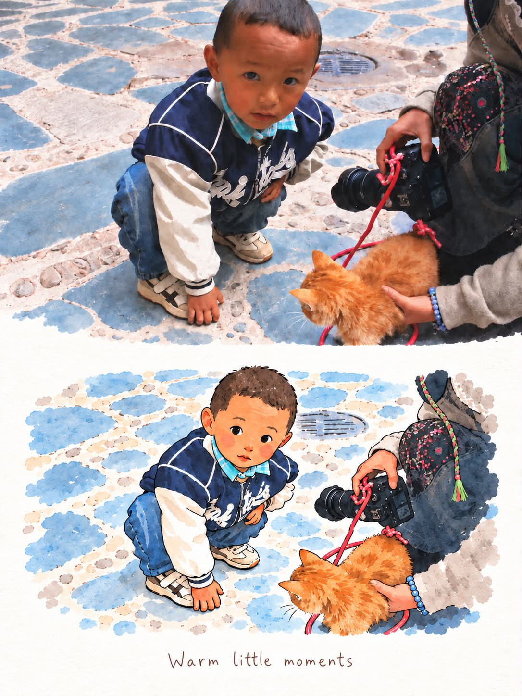

# 照片變成兒童繪本明信片

@nanali2637 分享一組提示詞，將生活或旅行照片製成 3:4 直式明信片：上半部保留原照，下半部轉成手繪兒童繪本插畫。重點是簡化造型，同時保留人物與動物的視線、動作和互動關係。[Threads 原貼文](https://www.threads.com/@nanali2637/post/DeLuJKCoMmK)

## 作者原始提示詞

[Threads 作者回覆](https://www.threads.com/@nanali2637/post/DeLuR7QoPtm)

```text
请将我上传的照片制作成一张“原照片 × 儿童绘本插画”的纪念明信片，记录日常生活或旅行中的温暖瞬间。
一、版式与构图
整张图片为3:4竖版，上方为原照片，下方为儿童绘本插画。上下两个区域等宽、等高，高度比例严格为1:1，分界位于整张图片高度的50%。
上方照片保留自然的色彩、曝光、清晰度和摄影质感，不提高饱和度、不锐化、不增加HDR或绘画滤镜。适度裁切以适配版式，保留关键主体和互动关系，不拉伸画面。
下方插画包含场景、纸白和题字。主体场景居中、饱满，左右各保留约5%—8%的纸白，上方留出适量空隙，下方留出题字空间。不要把主体缩成孤零零的小图标。
插画采用自然、不规则的开放式边缘，不做椭圆形裁切，不用规则矩形色块框住场景，不添加边框或投影。
二、核心画风
采用富有童真、稚拙和灵动感的手绘儿童绘本风格，以略不工整的墨线搭配清透、温暖的水彩色块。
将照片中的场景重新转译为绘本语言：造型简洁，比例略有夸张，空间关系带一点天真的不标准感。人物、动物和物件可以适度变形，画面各部分的大小可以重新安排，让故事更清楚、构图更舒服。
梦幻感来自富有想象力的造型、自由的透视、轻盈的色块和有感情的线条。不要依靠模糊、柔焦、发光、星光或滤镜制造梦幻感。
避免写实水彩、照片描摹、精细自然主义绘画、3D卡通和光滑矢量插画。
三、必须保留的故事信息
准确保留原照片中人物和动物的：
眼神落点、头部朝向、表情、身体姿势、手部动作，以及彼此的距离、遮挡和互动关系。
看向镜头的人仍然看向镜头，不能改成低头看动物。
背对镜头或脸部被遮挡的人，不要补画正脸。
原本安静、好奇或略微张嘴的表情，不要擅自改成笑脸。
保留具有叙事作用的细节，例如帽子形状、主要服装配色、牵引绳、相机，以及手与动物接触的位置。
简化材质，不删掉故事；调整造型，不改变互动。
四、人物与动物
人物采用简洁、亲切的绘本造型，用少量点、短线和小色块表达五官，通过眼睛的位置与方向准确传达视线。
脸部色彩平坦、温暖，不画写实鼻梁、眼窝和皮肤纹理，不统一套用大眼睛、婴儿脸或夸张卖萌表情。
身体轮廓柔软、略带笨拙，姿态有生活感。
动物用整体轮廓、主要色斑和少量边缘毛发短线表达，保留种类特征与神态，不逐根描绘毛发。
五、手绘描线
使用深棕黑或柔和黑色的细墨线，带轻微粗细变化、抖动、停顿和干涩感。
转折处允许钝角、小幅偏移或重新落笔；
个别轮廓可以断开；
两笔不必严丝合缝连接；
少量线条可以越过交点；
圆形、格子、窗户、砖块和矩形都不完全标准。
主体轮廓和关键结构有清楚的描线，背景用疏密变化的短线概括。避免均匀光滑的电脑轮廓，也不要用密集乱线填满画面。
六、涂色与细节
以明确的大色块为基础，结合透明水彩的浓淡变化。保留局部叠色、水痕、颜料沉淀和细小纸白。
涂色偶尔溢出轮廓，或留下少量未涂满的空隙，产生自然的手绘错位。色彩之间有轻微渗化，但主要形状仍然清楚。
衣服用主要色块和少量必要的褶线表达，不画纤维、绒毛和密集衣褶。
植物用成组色块、几笔草叶和少量叶片符号表达，不逐片复制，不画叶脉。
树干、石板、墙面和建筑保留辨识结构，用少量不规则线条提示材质。
画面丰富度来自物件关系、色块节奏和精选的小细节，不依赖写实纹理。
七、色彩与亮度
整体明亮、清透、温暖而鲜活。
暖色使用朱红、橘红、暖黄、赭石和自然棕色；
冷色使用清透天蓝、浅蓝和适量青绿；
绿色有鲜嫩与深浅变化，避免大片灰绿和脏橄榄色。
保留主体具有辨识度的原有配色，再转化为协调的绘本色彩。主体色块有足够浓度，但不荧光、不刺眼；背景适当轻淡，衬托主体。
暗部简洁克制，不让大面积深灰或黑色压住画面。
不要整体灰蒙蒙，也不要用泛黄滤镜制造温暖。
八、纸张、留白与晕染
下半部分呈现接近白色、略微温暖的哑光明信片纸面，带细微自然的纤维和吸水质感。纸纹轻而均匀，不盖过画面。
不要明显做旧、黄斑、污渍、浮雕纹理、裂纹或重复噪点。
场景外围的色块逐渐稀疏，局部淡淡晕开、断续消失，露出自然纸白。一些边缘保留清楚的笔触，另一些边缘让稀薄水色轻轻渗入纸面；墨线也可以在外围自然停笔、断开。
边缘有虚实变化，避免整圈均匀羽化、喷枪光晕和生硬裁切。
不要为了填满留白而添加无关的叶子、星星或装饰。
九、英文手写题字
在插画下方的留白处写一句简短、自然、符合场景的英文，不添加中文。若我指定文字，必须逐字使用。
题字像认真写在旅行明信片上的童趣落款：
细笔画、轻松、朴素，略带笨拙；
字母大小、高低和间距有轻微自然变化；
圆润但不肥厚，修长但不过分纤细；
少量字母自然连笔，其余允许停笔分开；
使用柔和暖棕色，与插画描线协调。
避免短粗奶酪体、气泡字、粗马克笔字和整齐的印刷字体。
避免成熟婚礼花体、强烈倾斜、夸张大写、长拖尾和复杂绕线。
不加独立下划线或装饰横线。
题字保持小巧、低调，最高字母约占整张图片高度的2%—2.5%，水平居中，底部留足纸白。
生成同一系列时，保持字高、笔画粗细和底部位置一致。短句自然占据更窄的宽度，不要为了填满区域而放大字号。
十、最终要求
输出完整的3:4竖版明信片。
上下区域高度严格为1:1。
保留原照片的摄影质感。
插画具有童真造型、不工整描线和清透暖色。
主体的视线、表情、动作和互动准确。
留白自然，边缘水彩晕染轻柔、有虚实变化。
题字小巧、有童趣。
不添加水印、作者签名、无关物件或额外文字。
```

## 作者示範圖

以下依主貼文輪播順序保存；四張均為 JPEG、1086 × 1448。作者回覆為文字提示詞，未見獨立圖片或影片。









## 提示詞重點

- **版式**：3:4 直式，上半部原照、下半部繪本插畫，各占一半。
- **畫風**：略不工整的手繪墨線、透明暖色水彩、自然紙白與開放式邊緣。
- **故事**：簡化造型，但保留人物與動物的視線、表情、姿勢、距離及互動。
- **題字**：底部加入小巧的英文手寫短句；若有指定文字則逐字使用。
- **避免**：過度寫實、3D 卡通、泛黃濾鏡、無關裝飾或改變原本互動。

## 自己試作時

1. 選一張互動清楚的生活或旅遊照，並確認照片中人物同意使用。
2. 上傳照片並貼入作者提示詞；若要指定題字，先寫明文字。
3. 檢查原照是否保留，並核對人物的視線、表情、動作與英文題字。
