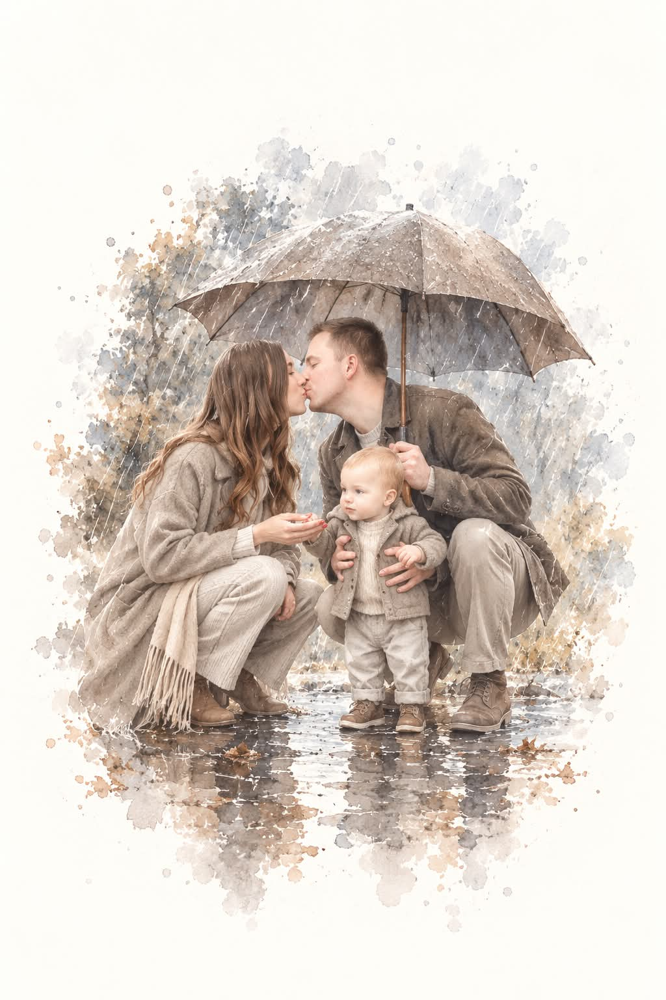
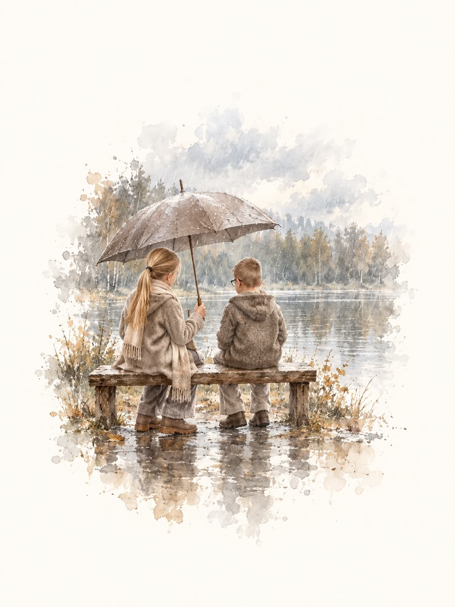
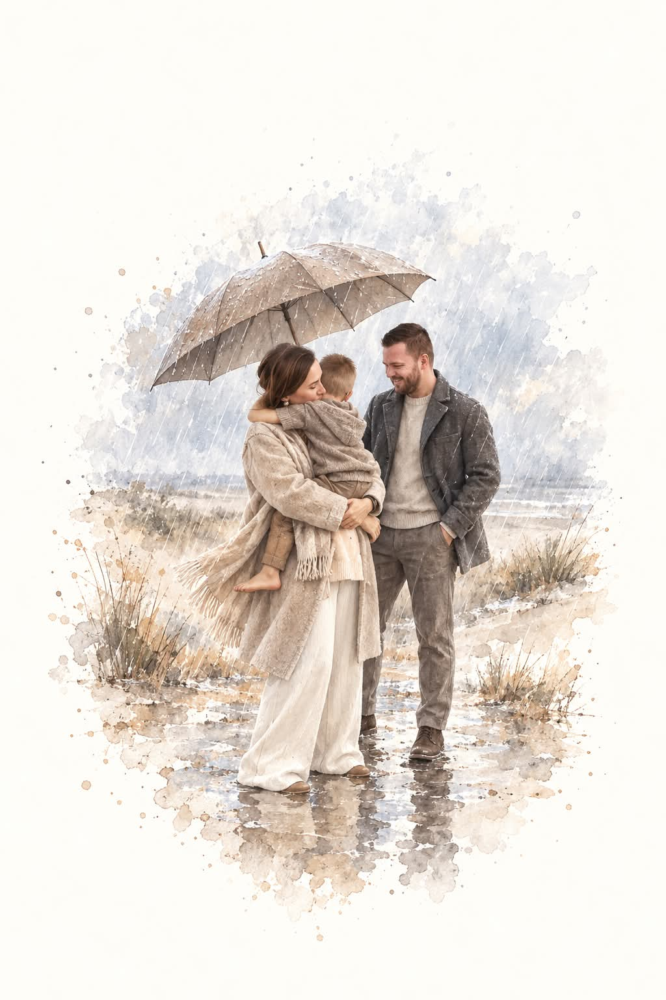
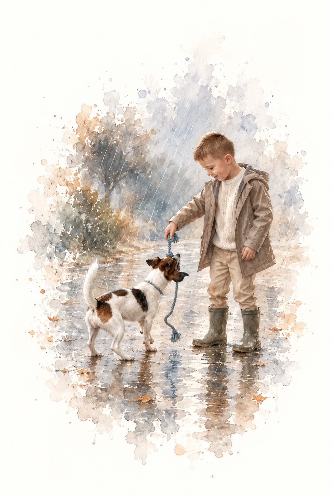

# 雨日家庭照的秋日水彩畫

@promptsbyjane 分享「Rainy Day — Soft October Edition」提示詞，將人物照片轉成雨日水彩畫：人物集中在畫面中央，以暖白留白、細雨和濕地倒影營造安靜的秋日氛圍。[Threads 原貼文](https://www.threads.com/@promptsbyjane/post/DeKfj5IACsd)

## 作者的英文提示詞

[Threads 作者回覆](https://www.threads.com/@promptsbyjane/post/DeKfnefAHIw)

```text
RAINY DAY — SOFT OCTOBER EDITION

Transform this photo into a refined, minimalist contemporary rainy October artwork on a large warm white or soft ivory background.

Identity preservation is the highest priority. Keep every person immediately recognizable as the exact same individual from the reference photo. Preserve their facial structure, face shape, eyes, nose, lips, smile, eyebrows, hairline, hairstyle, age, proportions, expression, pose, interaction and distinctive features. Do not beautify, idealize, redesign or reinterpret the faces. The painted treatment may gently soften texture and introduce delicate brushwork, but it must never alter facial geometry, expression or identity.

Keep the same people, same number of people, same relationship and natural interaction as in the original photograph. Preserve the emotional character of the original moment rather than replacing it with a generic posed scene.

Place the people within a small, intimate rainy October scene positioned only in the center of the composition, surrounded by a very large amount of clean warm-white negative space. The illustration should feel like a precious fragment of a rainy memory painted onto a page of a contemporary luxury art book.

Do not create a city or urban environment. No buildings, storefronts, cars, traffic, street signs, lampposts, skyscrapers or recognizable city architecture. Instead, suggest a quiet, undefined outdoor setting through a small area of rain-darkened ground, subtle puddles, delicate reflections and atmospheric moisture. The environment should remain minimal, abstract and secondary to the people.

Introduce the feeling of a soft October rain: fine diagonal raindrops, a light mist in the air, delicate water ripples, subtle wet reflections beneath the figures and a softly luminous grey-blue overcast sky suggested through translucent painterly washes. Include an elegant umbrella where compositionally appropriate, integrated naturally into the scene rather than dominating it.

Avoid making autumn leaves the main visual device. If any natural autumn details appear, keep them extremely sparse and understated. The October atmosphere should come primarily from rain, cool air, wet surfaces, reflections, diffused light and sophisticated seasonal clothing.

Restyle the people in an elegant Loro Piana-inspired 2026 autumn wardrobe. The clothing should feel contemporary and current while maintaining timeless Italian quiet luxury: exceptional cashmere, fine wool, brushed suede, refined waterproof outerwear and beautifully tactile natural fabrics with relaxed, impeccable tailoring.

Use sophisticated pieces such as a softly structured raincoat, luxurious cashmere coat, refined overshirt, fine-knit sweater, elegant cardigan, relaxed tailored trousers or a minimal flowing skirt. Silhouettes should feel modern 2026, effortless, understated and expensive, with minimal layering and almost no accessories.

Keep the wardrobe within a restrained palette of warm ivory, cream, oatmeal, stone, sand, mushroom, camel, cappuccino, greige and soft taupe, complemented by subtle rainy tones of mist grey, pearl grey, smoky blue-grey and desaturated slate blue. No visible branding or logos.

The overall palette should be sophisticated and muted: warm white + noble beige + misty grey-blue. Avoid saturated blue, bright colors, strong orange, red or yellow. Keep everything soft, tonal and harmonious.

Render the people and environment in delicate soft gouache, watercolor and sophisticated dry-brush painting, with subtle handmade texture, translucent rainy washes, fine pigment variation and beautifully unfinished edges.

The painted scene must fade and dissolve naturally into the untouched white/ivory background. There should be no rectangular image boundary, no hard frame and no full-background scenery. Keep approximately 65–75% of the overall canvas as clean negative space, with the painted memory concentrated elegantly in the center.

Keep the faces noticeably more precise, detailed and recognizable than the surrounding painterly elements. Clothing may have beautiful tactile brushwork suggesting cashmere, wool and suede, while rain, reflections and background elements should remain loose, airy and impressionistic.

Use soft diffused overcast light with a slightly luminous, pearlescent quality. Let tiny highlights shimmer subtly in the wet ground and puddles. Reflections should be blurred, delicate and painterly rather than photorealistic.

The final artwork should feel like a quiet October afternoon caught in gentle rain — intimate, modern, serene and collectible. Think cool rain meeting warm cashmere: contemporary Italian elegance, misty grey-blue atmosphere, noble neutral clothing, delicate reflections and enormous white breathing space.

No facial changes, no generic AI faces, no beautification, no altered expressions, no changed pose or relationship between the people, no photorealism, no city, no buildings, no urban street scene, no cars, no crowds, no dramatic storm, no heavy dark clouds, no excessive autumn leaves, no saturated orange or red palette, no bright blue, no rustic aesthetic, no hard frame, no rectangular background, no collage, no logos, no text, no excessive accessories, no excessive details.
```

## 作者示範圖

依主貼文輪播順序保存，均為 JPEG。作者回覆為文字提示詞，未見獨立圖片或影片。









圖片解析度依序為 1024 × 1536、1086 × 1448、1024 × 1536、1024 × 1536。

## 提示詞重點

- **保留人物身分**：維持臉部特徵、表情、姿勢、人數與彼此互動。
- **構圖與風格**：人物集中於中央，約 65–75% 畫面留白；使用水彩、水粉與乾筆觸。
- **色彩與場景**：暖白、米色、灰藍為主，以細雨、水窪和柔和倒影呈現秋日氛圍，避免城市建築與暴風雨。
- **服裝**：以義式低調奢華秋裝為靈感，強調喀什米爾、羊毛等材質，不加品牌標誌。

## 自己試作時

1. 選擇經人物同意的參考照片，並確認使用的產圖服務如何處理照片。
2. 上傳照片並貼入作者的英文提示詞。
3. 核對臉部、人數、表情與互動；提示詞要求保留身分，但成品仍需人工確認。
