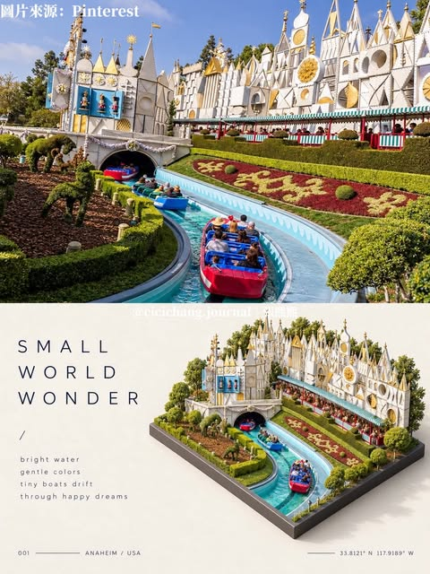
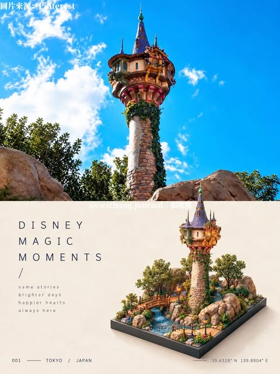
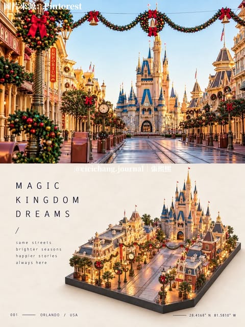

# 把旅遊照變成等角微縮模型海報

@cicichang.journal 示範如何把旅遊照做成一張 3:4 的直式海報。上半部保留原照，下半部以 45° 俯視角將建築與周邊環境重建為寫實的等角微縮場景，再搭配暖白底、留白、短詩與地點資訊。[Threads 原貼文](https://www.threads.com/@cicichang.journal/post/DeK_osFn9rN)

## 作者的英文提示詞

[Threads 作者回覆](https://www.threads.com/@cicichang.journal/post/DeK_oLGH2Xc)

```text
3:4 vertical image, two stacked halves, no gap. TOP: the uploaded photo, unaltered, full width. BOTTOM: minimalist editorial poster. Rebuild the photo's architecture and surroundings as a hyper-detailed isometric miniature diorama (45° high angle), keeping original structure, materials, colors and day/night lighting, on a thin dark-gray base slab. Warm off-white paper background, diorama lower-right, generous negative space. Thin dark-navy sans-serif text: left-middle 3-line uppercase poetic title, "/" and a 4-line verse; bottom-left "001", thin line, CITY / COUNTRY; bottom-right thin line and GPS coordinates. Auto-identify the location and write all text. Photorealistic 3D render, quiet premium travel-journal style, no logo, no watermark.
```

## 作者示範圖







## 提示詞重點

- **上下對照**：使用 3:4 直式畫布，上下各半、中間無縫。上半部滿版保留原照，下半部做成極簡旅遊海報。
- **微縮場景**：以 45° 俯視的等角視角重建建築與周邊環境，保留原有結構、材質、色彩和日夜光線。模型放在薄的深灰色底座上，採寫實 3D 渲染。
- **海報排版**：使用暖白紙底，模型靠右下，左側保留留白。用細版深藍色無襯線字排三行大寫標題及四行短詩，底部放編號 `001`、城市／國家與 GPS 座標。整體呈現旅行手帳風格，避免標誌與浮水印。

## 自己試作時

1. **挑選照片**：選一張主體清楚、帶有周邊街景或地景的旅遊照，讓模型有足夠的參考細節。
2. **補上地點**：上傳照片並貼入提示詞。若已知拍攝地點，可直接填入城市、國家與座標。原提示詞會請模型自行辨識地點。
3. **檢查成品**：確認上半部仍是原照，下半部保留了建築特徵與原本的光線，並核對海報上的地名、GPS 座標與排版文字。
