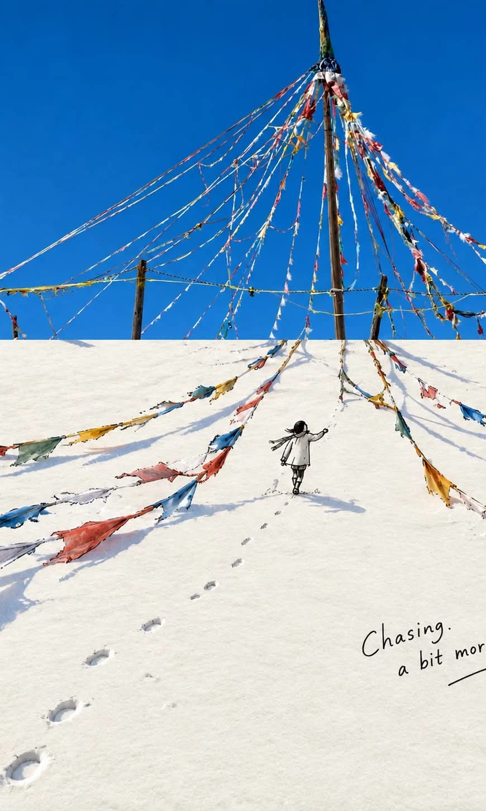
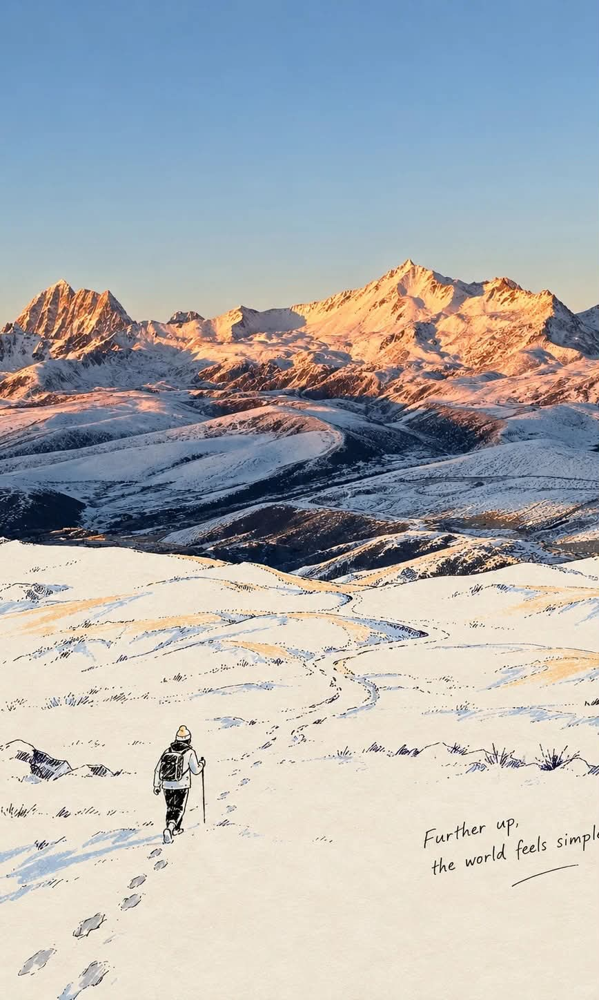
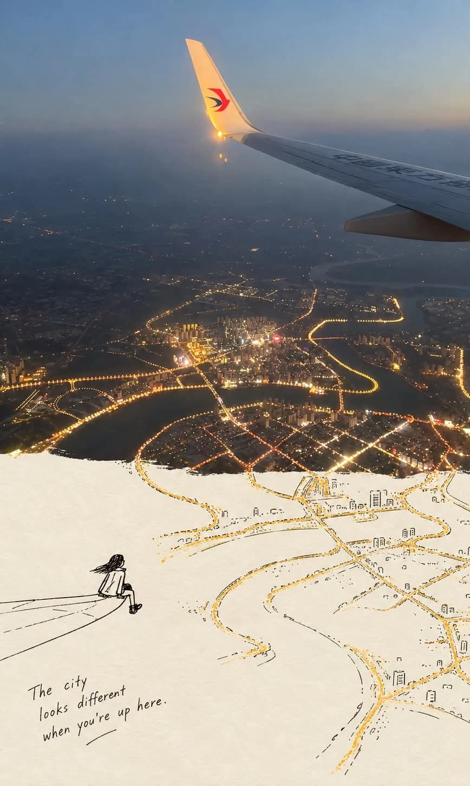

# 旅遊照片的「第二世界」海報

@ammiamia_ 分享一個將旅遊照變成「第二世界」海報的提示詞：上半部保留照片，下半部從照片中的線條、光影或空間結構出發，以暖米白紙張和簡單黑線人物創造新的場景。重點是理解照片，不是套用固定的撕紙與小人模板。[Threads 原貼文](https://www.threads.com/@ammiamia_/post/Dd--W2MGyUH)

## 作者原始提示詞

[Threads 作者回覆](https://www.threads.com/@ammiamia_/post/Dd--Wo4G0qw)

```text
請基於我上傳的攝影作品，製作3:4豎版的「第二世界」攝影二創海報。整體嚴格上下 1:1：上半部盡可能忠實保留原照片，不改變主體、人物動作、空間關係、色彩和自然光影，只做必要的等比裁切。下半部使用自然的暖米白紙張背景，保留大量留白。但不要直接套用「撕紙＋小人」的固定模板。生成前，請先認真觀察這張照片：

1.找出照片裡最有辨識度的視覺結構，而不只是辨識題材。例如水波、道路、倒影、雲、枝條、光束、影子、建築邊緣、人物動作、山脊等。

2. 問自己：「如果照片裡的這個結構真的變成一種可以被觸碰、使用或改變的東西，它最自然會是什麼？」由此找到只屬於這張照片的「第二世界」。可能發生的變化包括但不限於：拉、推、撥開、進入、打撈、測量、修補、展開、鋪平、攀爬、連接、收集.⋯⋯•但不要機械復用這些動作。

3.攝影剪貼的形狀本身也必須參與解釋照片。不要預設使用普通不規則撕紙邊。水可以成為一塊小水域，光可以成為某種可被借用的東西，道路可以繼續延伸，雲或樹枝也可能形成新的空間關係。具體答案必須從這一張照片本身產生。

4. 可以加入0-3個極簡黑色手繪線稿人物。小人不是裝飾，而是這個第二世界裡的「使用者」。他們必須真正與照片中的物理結構互動，而不是站在旁邊擺姿勢。如果原照片已經有很強的人物動作，可以不新增小人。

5.根據這張照片具體發生的事情，產生一句簡短英文手寫旁白。語調自然、輕鬆、有一點幽默或畫外音感。不要寫成勵志語錄，也不要重複「Same..different." 這類固定句式。文字位置依畫面留白和動作方向決定，不固定在某個角落。整體風格：真實攝影＋米白紙張＋極簡黑線塗鴉，乾淨、明亮、克制、有輕微手工拼貼感和獨立雜誌感。不要：廣告感、複雜插畫、密集小人、固定撕紙模板、重複動作、為了好看隨意添加樹葉星星等裝飾、擅自改變原照片色彩或重新設計攝影內容。最重要的原則：不要裝飾照片。先理解照片，再發現它裡面原本可能存在的另一個世界。理想結果應該讓人看到後覺得：原來這張照片本來可以這樣理解。 "
```

## 作者示範圖

依主貼文輪播順序保存。圖片實際比例約為 3:5，與提示詞要求的 3:4 不完全一致。







三張均為 JPEG；解析度依序為 870 × 1450、868 × 1448、868 × 1448。

## 提示詞重點

- 上下各半；上半部盡可能保留原照，只做必要的等比裁切。
- 下半部以照片中特有的線條、光影與空間結構構思「第二世界」。
- 可加入 0–3 個黑線小人，讓小人與照片結構互動，而非純粹裝飾。
- 依畫面內容產生簡短自然的英文旁白，避免固定句式。
- 避免重複使用撕紙模板、加入無關裝飾或擅自改變原照。

## 自己試作時

1. 選一張有明顯線條、光影或空間關係的旅遊照。
2. 上傳照片並貼入作者提示詞。
3. 檢查原照是否忠實保留，以及下半部互動是否真的源自照片內容；核對畫幅比例與英文文字。

## 回覆與媒體狀態

作者可見的回覆提供文字提示詞，未見獨立圖片或影片。其他使用者的回覆圖片未收錄；頁面提示部分新增回覆無法顯示。
