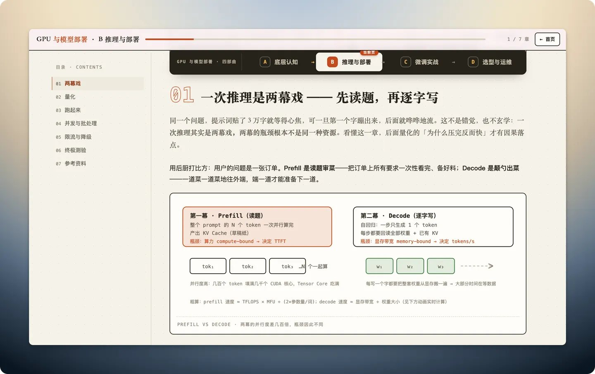

# know-as-ui：可互動探索的 AI 技術教程

## 摘要

@javayhu 推薦由 limbo 製作的 [know-as-ui](https://dev.limbo101.win/)，將 AI 與軟體工程知識整理成互動式 HTML 教程。網站依主題提供文字解說、可視化圖示、模擬器與測驗，適合用來理解 Agent、模型推理及部署等技術概念。[Threads 原貼文](https://www.threads.com/@javayhu/post/DdxcalhiSBA)

## 教程主題

截至 2026-11-26，網站首頁列出四個主題分類、共十個教程頁：

- **Coding Agent（4 頁）：**Pi ReAct Agent、Agent Loop、擴充功能與上下文管理。
- **Agent 架構（2 頁）：**DeepSeek Harness 的 Cordis／插件開發，以及 Subagent 與多 Agent 架構。
- **LLM Infra（3 頁）：**RAG／向量資料庫、GPU 與模型部署、LLM 前綴快取。
- **判斷模型（1 頁）：**JEV TypeSafe 判斷模型。

貼文作者提到，教程協助他理解模型參數、本機部署配置、TTFT、輸出 Token 速度、權重精度、KV Cache、並發、上下文、頻寬、Prefill 與 Decode 等概念。

## 資源與媒體

- [互動式教程網站](https://dev.limbo101.win/)
- [GitHub 專案](https://github.com/limboinf/know-as-ui)
- 主貼文附 1 張教程截圖（JPEG，1440 × 906），畫面是 GPU／模型部署單元中解說 Prefill 與 Decode 的頁面；未見影片。
- Threads 貼文顯示尚無回覆。

## 授權與更新提醒

- GitHub 專案頁目前未標示明確授權；使用或轉載教程內容前，先向作者確認授權。
- 網站內容可能持續更新；上列分類與頁數依 2026-11-26 查看時記錄，請以[網站首頁](https://dev.limbo101.win/)為準。
