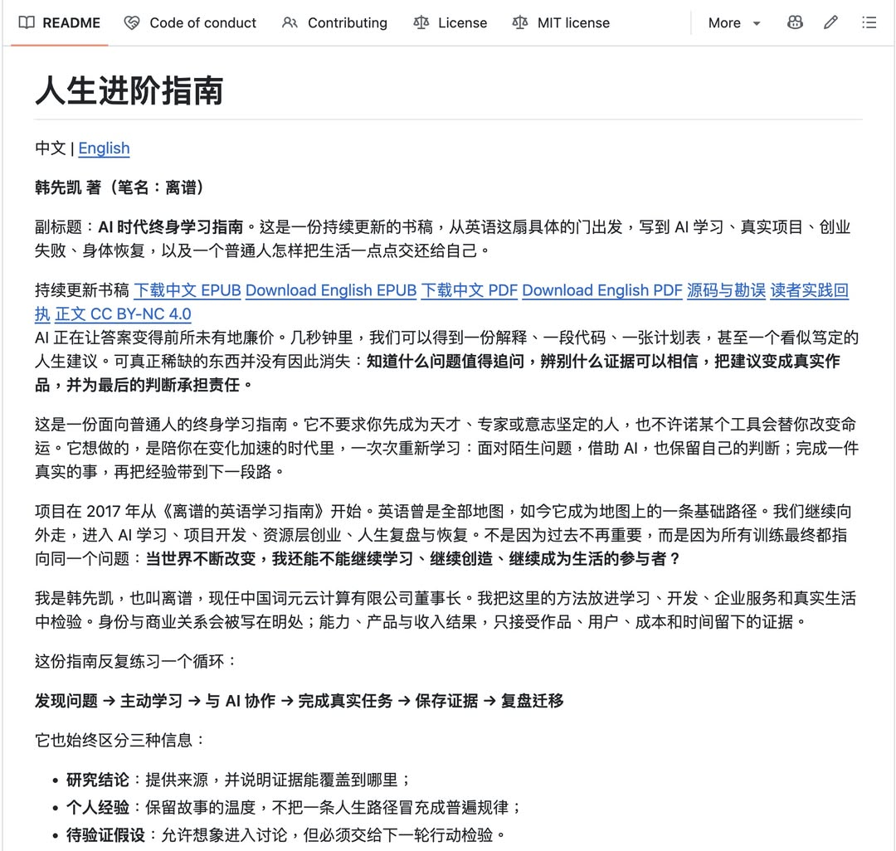

# 《人生進階指南》：從英語學習到 AI 時代終身學習

## 摘要

@edjumptw 分享 GitHub 專案 [byoungd/up《人生進階指南》](https://github.com/byoungd/up)，以大量英文輸入、AI 陪練及真實情境練習概括其中的英語學習思路。貼文作者表示自己依口說練法練習兩週後感覺更順；這是個人經驗，不代表已驗證的普遍成效。[Threads 原貼文](https://www.threads.com/@edjumptw/post/Dd21xC-Grvl)

專案作者韓先凱（筆名「離譜」）表示，內容始於 2017 年的《離譜的英語學習指南》，後續擴展為涵蓋英語、AI 學習、真實專案及人生經驗的持續更新書稿。可從[線上閱讀版](https://byoungd.github.io/up/)瀏覽目前內容。

## 專案與閱讀入口

- [GitHub 專案](https://github.com/byoungd/up)
- [線上閱讀版](https://byoungd.github.io/up/)
- [重新學習，打開輸入](https://github.com/byoungd/up/blob/main/docs/threads/part-1/open-input.md)
- [CEFR 自測](https://github.com/byoungd/up/blob/main/docs/threads/part-1/0-cefr.md)

## 專案重點

- **英語學習觀點**：貼文著重大量輸入與口說練習；GitHub README 更將整體方法描述為「發現問題 → 主動學習 → 與 AI 協作 → 完成真實任務 → 保存證據 → 復盤遷移」。
- **內容範圍**：除了英語學習，也包含 AI 協作、專案實作、創業經驗與個人復盤等內容；不只是單一英語課程。
- **專案性質**：這是開放內容書稿，不是一般可執行的開源軟體專案。README 說明正文採 CC BY-NC 4.0，網站配置與工具程式碼採 MIT 授權。
- **人氣數字**：原貼文稱專案有六萬多顆 Star；收集時 GitHub 頁面約顯示 70.9k。星數會隨時間改變，也不代表內容品質或學習成效已獲驗證。

## 作者回覆

作者在可見回覆中分享其「陳執董的商業社群」連結，屬作者的社群宣傳，與本篇英語學習資源分開看待。Threads 頁面提示部分其他回覆無法顯示。

## 圖片

主貼文附 1 張 GitHub README 截圖，展示《人生進階指南》的專案介紹及其 AI 時代終身學習定位；JPEG，1080 × 1026。

主貼文未見影片。
