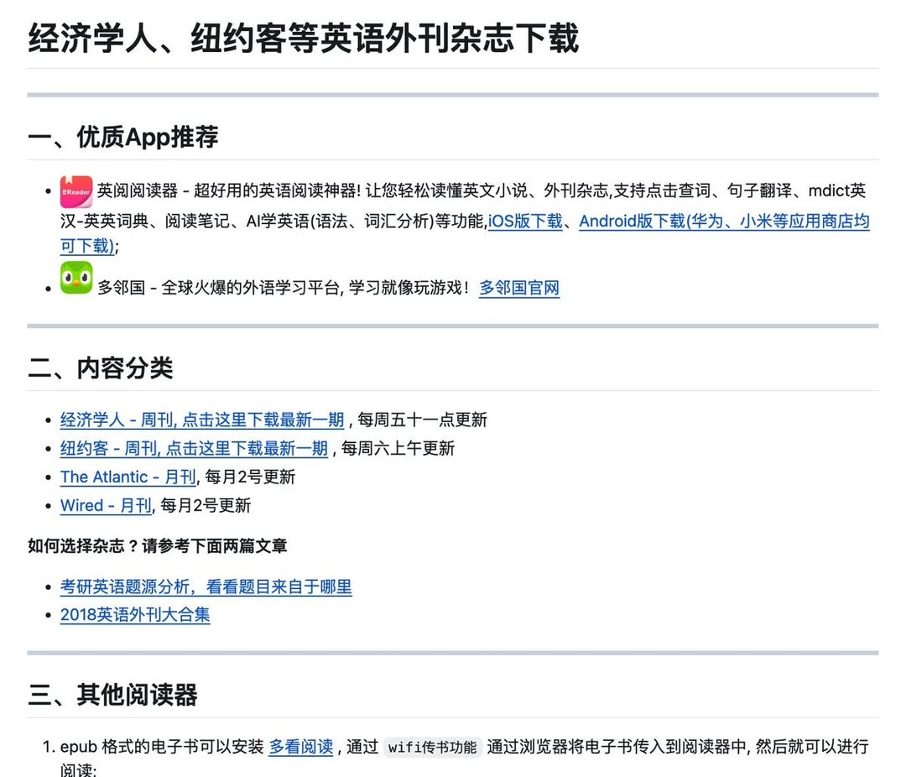

# Awesome English Ebooks：英文外刊閱讀資源

## 摘要

@nameizhishiku 分享 GitHub 專案 [hehonghui/awesome-english-ebooks](https://github.com/hehonghui/awesome-english-ebooks)，將閱讀英文外刊的下載連結集中整理。貼文提到《經濟學人》《紐約客》《連線》《大西洋月刊》《衛報》，並稱提供 PDF、EPUB、MOBI 格式。[Threads 原貼文](https://www.threads.com/@nameizhishiku/post/DeeKf_Vj0r3)

## 專案內容

GitHub 專案描述宣稱提供《經濟學人》（含音訊）、《紐約客》《衛報》《連線》《大西洋月刊》等外刊，並標示 PDF、EPUB、MOBI 格式及更新頻率。README 目前的內容分類則列出：

- 《經濟學人》週刊
- 《紐約客》週刊
- The Atlantic 月刊
- Wired 月刊

README 所列分類與貼文提及的刊物不完全相同；使用前請以專案當下的目錄和說明為準。

## 授權與使用提醒

外刊屬出版品內容；目前可見的 GitHub 專案首頁與 README 未提供這些下載內容的授權說明。不要因為檔案放在 GitHub，就假設可自由下載、轉載或散布。建議優先確認出版社授權與所在地規範，或使用出版社官方網站、圖書館及合法訂閱來源；本筆記不保存或鏡像外刊檔案。

## 圖片與回覆

主貼文附 1 張 README 截圖，展示閱讀 App 推薦、外刊分類及其他閱讀器說明；JPEG，1080 × 926。未見影片。可見留言多為收藏回應，沒有補充授權或資源來源的實質資訊。

