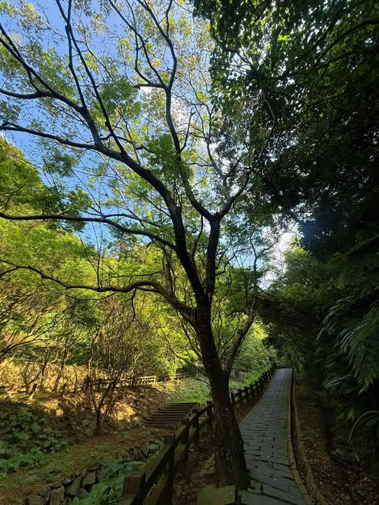
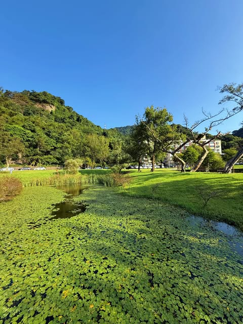
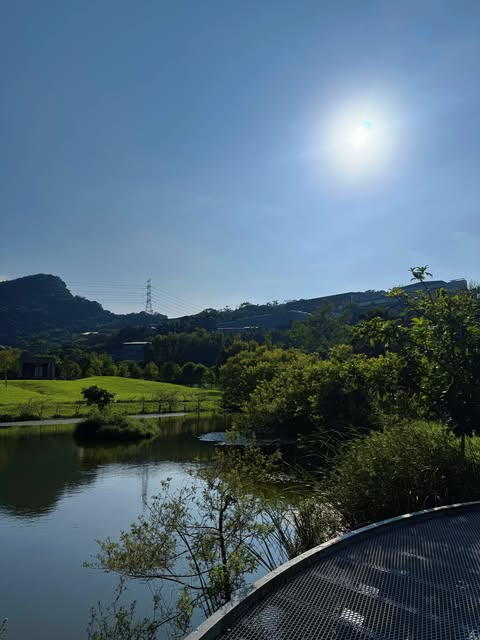

# 永春陂生態濕地公園

## 摘要

@berylwei03 推薦在溪流與綠意間輕鬆散步，適合週末踏青。留言指出地點是永春陂濕地公園，作者也[確認了這點](https://www.threads.com/@berylwei03/post/DeEfChtkpKK)。[Threads 原貼文](https://www.threads.com/@berylwei03/post/DeEQt1kEq-Y)

## 景點資訊

- **地址**：臺北市信義區松山路 657 號。
- **交通**：作者[表示](https://www.threads.com/@berylwei03/post/DeETcG2kmdo)靠近奉天宮站，主文提到捷運出站約 10 分鐘；可由廣慈／奉天宮站前往，實際步行時間依入口與路線而異。
- **官方資料**：[臺北旅遊網：永春陂生態濕地公園](https://www.travel.taipei/zh-tw/attraction/details/2262)。
- **提醒**：園區設有管制區，請依現場告示活動。

## 內文或摘錄

> 台北竟然有這樣的地方！🌿  
> 不用開車、不用跑到郊區，  
> 捷運出站約10分鐘，就能走進溪流、綠意與滿滿自然感。  
> 沿著溪畔慢慢走，  
> 聽著潺潺流水、吹著舒服的風，  
> 真的會有種「這裡竟然在台北？」的錯覺。  
> 不用安排一整天，  
> 週末想找個地方散散步、放空、帶孩子走走，  
> 這種 **交通方便＋不用爬太累＋又有溪流景色** 的地方真的很可以！  
> 📍捷運溪流步  
> 🚇 出站約10分鐘  
> 🌿 輕鬆散步  
> 💦 溪流景色  
> 👧 親子／週末踏青都適合  
> 先收藏起來，  
> 下個週末就去走走吧！

## 圖片

以下依主貼文輪播順序保存 3 張照片，展示林蔭步道與濕地水景；均為 JPEG、480 × 640。

作者可見的兩則回覆為文字，確認位置，未見獨立圖片或影片。
